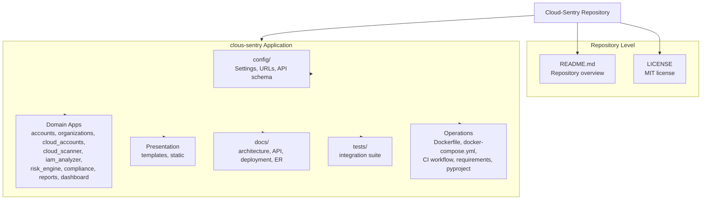
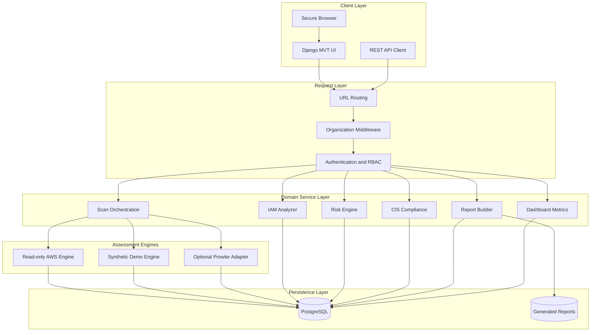
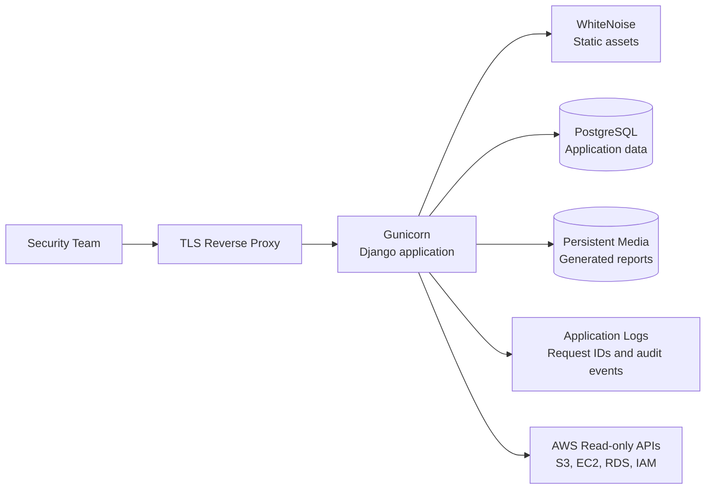
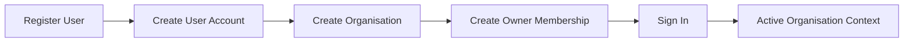
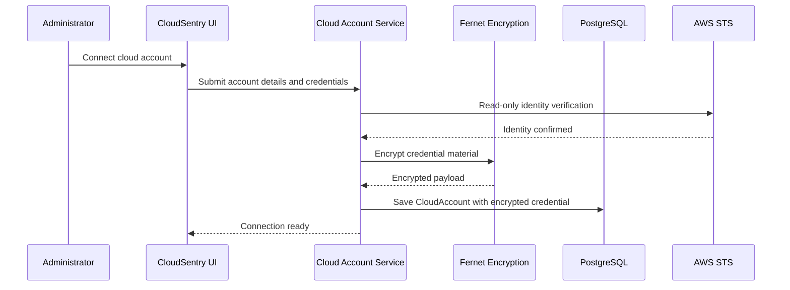
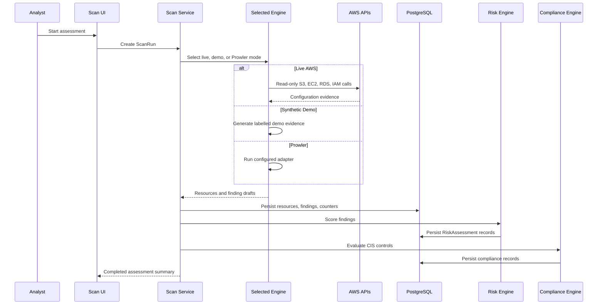
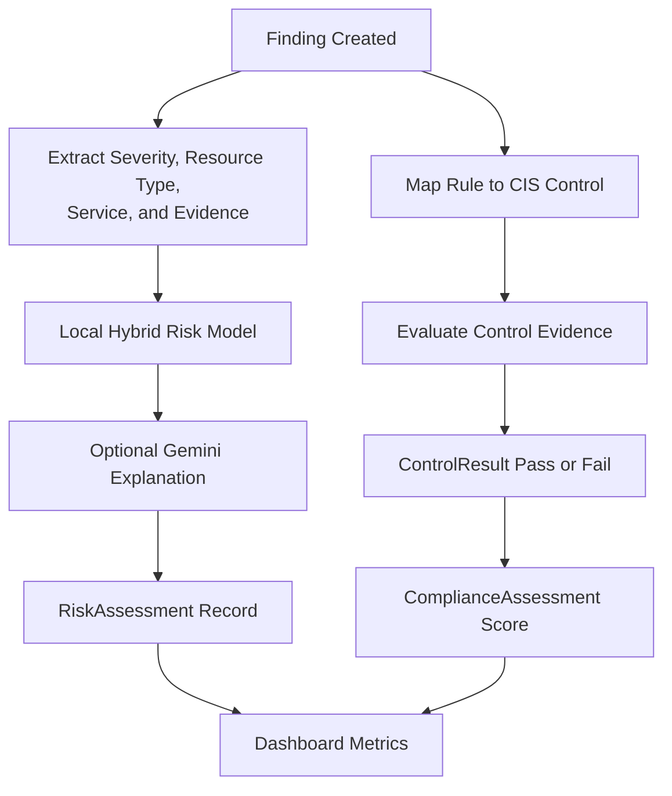
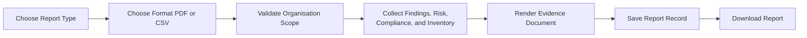
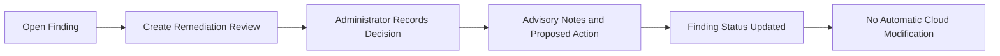

# CLOUDSENTRY

**AI-Powered Cloud Security Posture Management Platform**

| Document item | Detail |
| --- | --- |
| Repository | `Njbalamani/Cloud-Sentry` |
| Application folder | [`clous-sentry/`](./clous-sentry/) |
| Document date | 24/11/2026 |
| Platform name | CLOUDSENTRY |
| Primary stack | Django 5, Django REST Framework, PostgreSQL |
| Deployment | Local development, Docker Compose, Gunicorn, WhiteNoise |
| License | MIT License, Copyright (c) 2026 Njbalamani |

CloudSentry is a complete Cloud Security Posture Management platform for managing cloud accounts, running read-only AWS assessments, analysing IAM permissions, scoring risk, evaluating CIS controls, visualising security posture, and exporting professional PDF or CSV reports.

This root README is the repository landing page. The complete application-level documentation, including column-level database tables and the full command reference, is in [`clous-sentry/README.md`](./clous-sentry/README.md).

---

## Table of contents

| No. | Section | What it contains |
| --- | --- | --- |
| 1 | [Overview](#1-overview) | Product purpose, capability matrix, and design principles |
| 2 | [Repository map](#2-repository-map) | Folder tree, structure diagram, and ownership matrix |
| 3 | [Product architecture](#3-product-architecture) | Layered architecture, deployment topology, and security boundaries |
| 4 | [End-to-end workflows](#4-end-to-end-workflows) | Workflow index, assessment lifecycle, risk, compliance, and reporting flows |
| 5 | [Modules and data](#5-modules-and-data) | Django app matrix and database table index |
| 6 | [Quick start](#6-quick-start) | Prerequisites, local setup, and Docker setup |
| 7 | [Verification](#7-verification) | Validation commands and expected checks |
| 8 | [Documentation index](#8-documentation-index) | Links to all detailed documents |
| 9 | [License](#9-license) | License ownership and references |

---

## 1. Overview

### 1.1 Product purpose

| Area | Description |
| --- | --- |
| Security posture | Centralises cloud misconfigurations, IAM findings, risk scores, and compliance results in one workspace. |
| Tenant model | Every organisation has isolated cloud accounts, findings, assessments, reports, and dashboard metrics. |
| Assessment model | Supports live read-only AWS scanning, synthetic demo scanning, and an optional Prowler adapter. |
| Risk model | Uses deterministic rule severity plus local machine-learning scoring with optional Gemini explanation enrichment. |
| Compliance model | Maps security rules to CIS AWS Foundations Benchmark v2.0 controls and stores per-control evidence. |
| Reporting model | Generates PDF and CSV evidence packages with organisation, scan, finding, risk, and compliance data. |

### 1.2 Capability matrix

| Capability | User value | Main implementation |
| --- | --- | --- |
| Organisation workspaces | Multiple tenants with isolated data | `organizations` app and active organisation middleware |
| Role-based access | Owner, administrator, analyst, and viewer permissions | `accounts/permissions.py` |
| Secure cloud connections | Encrypted credential storage and read-only assessment | `cloud_accounts` and Boto3 engine |
| Security rules | Rule catalogue with remediation and CIS mapping | `cloud_scanner/rules.py` and `ScanRule` |
| Finding management | Investigation, filtering, status tracking, and evidence | `Finding`, scan views, and REST API |
| IAM least privilege | Policy review and over-privilege recommendations | `iam_analyzer` app |
| Risk scoring | Hybrid score, severity band, factors, and explanation | `risk_engine` app |
| CIS compliance | Control evaluation and assessment scoring | `compliance` app |
| Executive dashboard | Database-derived charts, counters, and topology | `dashboard` app |
| Evidence reporting | PDF and CSV report generation | `reports` app |
| Demo safety | Clearly labelled synthetic records | `is_demo` and `synthetic_data` fields |

### 1.3 Design principles

| Principle | Implementation in this repository |
| --- | --- |
| Read-only cloud access | Live AWS scanning calls descriptive APIs only and never changes cloud resources. |
| No hardcoded dashboard values | Dashboard metrics are calculated from organisation-scoped database queries. |
| Synthetic data transparency | Demo records are labelled as demo and are never presented as live findings. |
| Credential protection | Cloud credentials are encrypted at rest and excluded from UI and API serializers. |
| Explicit approval model | Remediation reviews are advisory records; automatic remediation is never performed. |
| Tenant isolation | Domain queries are filtered by the active organisation. |
| Professional handover | README files, diagrams, database dictionaries, tests, Docker, CI, and deployment notes are included. |

---

## 2. Repository map

### 2.1 Repository tree

```text
Cloud-Sentry/
├── LICENSE                         Repository-level MIT license
├── README.md                       Repository landing documentation
└── clous-sentry/                   Complete Django application
    ├── .dockerignore               Docker build exclusions
    ├── .env.example                Environment variable template
    ├── .github/
    │   └── workflows/
    │       └── ci.yml              Django checks, tests, and Ruff workflow
    ├── .gitignore                  Git exclusion rules
    ├── Dockerfile                  Production container image
    ├── LICENSE                     Application MIT license
    ├── README.md                   Full application documentation
    ├── docker-compose.yml          PostgreSQL and web service stack
    ├── manage.py                   Django management entry point
    ├── pyproject.toml              Ruff and pytest configuration
    ├── requirements.txt            Python dependency manifest
    ├── accounts/                   Identity, roles, permissions, authentication
    ├── organizations/              Tenants, membership, active organisation context
    ├── cloud_accounts/             Cloud account registry and encrypted credentials
    ├── cloud_scanner/              Rules, scan runs, findings, scan engines
    ├── iam_analyzer/               IAM policy analysis
    ├── risk_engine/                Risk scoring and explanations
    ├── compliance/                 CIS controls and assessments
    ├── reports/                    PDF and CSV report generation
    ├── dashboard/                  Metrics, charts, topology, dashboard API
    ├── config/                     Settings, URLs, API schema, error handling
    ├── templates/                  MVT templates and reusable components
    ├── static/                     Custom CSS and JavaScript
    ├── docs/                       Architecture, API, deployment, ER docs
    ├── media/                      Generated report storage marker
    └── tests/                      Cross-application integration tests
```

### 2.2 Repository structure diagram



### 2.3 Folder responsibility matrix

| Path | Responsibility | Detailed content |
| --- | --- | --- |
| `README.md` | Repository introduction | Quick map, architecture, workflow, and setup commands |
| `LICENSE` | Legal permission | MIT license in Njbalamani name |
| `clous-sentry/README.md` | Application handbook | Full setup, routes, APIs, diagrams, database dictionary, and operations |
| `clous-sentry/config/` | Django configuration | `settings.py`, `urls.py`, `api.py`, WSGI, ASGI, error handlers |
| `clous-sentry/accounts/` | Identity and access | Custom user, login attempts, RBAC helpers |
| `clous-sentry/organizations/` | Tenancy | Organisation model, membership, middleware, services |
| `clous-sentry/cloud_accounts/` | Cloud registry | Account connection, resource inventory, encrypted credentials |
| `clous-sentry/cloud_scanner/` | Assessment engine | Rules, scans, findings, AWS, demo, and Prowler engines |
| `clous-sentry/iam_analyzer/` | IAM analysis | Policy document analysis and least-privilege recommendations |
| `clous-sentry/risk_engine/` | Risk scoring | Model training, scoring, factors, and explanation |
| `clous-sentry/compliance/` | Compliance | CIS controls, assessments, and control results |
| `clous-sentry/reports/` | Evidence export | PDF and CSV generation |
| `clous-sentry/dashboard/` | Posture analytics | Metrics, topology, charts, dashboard API |
| `clous-sentry/templates/` | User interface | Dashboard, forms, tables, modals, errors, reusable components |
| `clous-sentry/static/` | Frontend assets | Design system, charts, interactions, topology renderer |
| `clous-sentry/docs/` | Deep documentation | Architecture, API, deployment, ER diagram references |
| `clous-sentry/tests/` | Verification | Core integration and security behaviour tests |

---

## 3. Product architecture

### 3.1 Layered architecture



### 3.2 Deployment topology



### 3.3 Security boundary model

| Boundary | Trust rule | Enforcement |
| --- | --- | --- |
| User to application | Authenticated session or token required | Django auth and DRF permissions |
| Request to organisation | Active organisation must be resolved | `OrganizationContextMiddleware` |
| User action to data | Minimum role must be satisfied | `accounts/permissions.py` |
| Application to database | Querysets are organisation scoped | Model managers and service filters |
| Application to cloud | Read-only credentials only | `is_read_only` field and Boto3 engine design |
| Credential storage | Secret material must be encrypted | Fernet encryption before persistence |
| Reporting | Exports stay inside tenant boundary | Organisation-filtered report data |
| Remediation | Advisory only | Review records never modify cloud resources |

---

## 4. End-to-end workflows

### 4.1 Workflow index

| No. | Workflow | Diagram | Main output |
| --- | --- | --- | --- |
| W1 | Platform provisioning | [Section 4.2](#42-platform-provisioning-workflow) | User, organisation, and owner membership |
| W2 | Cloud connection | [Section 4.3](#43-cloud-connection-workflow) | Encrypted cloud account and resource inventory |
| W3 | Assessment lifecycle | [Section 4.4](#44-assessment-lifecycle) | Scan run, resources, and findings |
| W4 | Risk scoring | [Section 4.5](#45-risk-and-compliance-workflow) | RiskAssessment records and explanation |
| W5 | Compliance evaluation | [Section 4.5](#45-risk-and-compliance-workflow) | ComplianceAssessment and ControlResult records |
| W6 | Reporting | [Section 4.6](#46-reporting-workflow) | PDF or CSV evidence package |
| W7 | Governance | [Section 4.7](#47-governance-workflow) | Advisory remediation review decision |

### 4.2 Platform provisioning workflow

| Step | Actor | Action | Result |
| --- | --- | --- | --- |
| 1 | User | Opens registration page | Registration form is displayed |
| 2 | User | Submits name, email, and password | User account is created |
| 3 | System | Creates default organisation | Tenant workspace is created |
| 4 | System | Creates owner membership | User receives full tenant access |
| 5 | User | Signs in | Active organisation context is established |



### 4.3 Cloud connection workflow

| Step | Actor | Action | Security control |
| --- | --- | --- | --- |
| 1 | Administrator | Enters account name, AWS account ID, region, and role | Organisation-scoped form |
| 2 | Administrator | Provides credential material | Input accepted only through secure form |
| 3 | System | Verifies credential with read-only metadata call | No write permissions requested |
| 4 | System | Encrypts credential with Fernet | Plaintext is never stored |
| 5 | System | Saves `CloudAccount` | `is_read_only=True` by default |
| 6 | System | Prepares account for scanning | `scan_enabled=True` by default |



### 4.4 Assessment lifecycle

| Stage | Input | Processing | Output |
| --- | --- | --- | --- |
| Start | Cloud account and mode | Validate role and organisation | `ScanRun` with `pending` status |
| Collect | Authorized account or demo catalogue | Discover S3, EC2, RDS, and IAM evidence | `CloudResource` records |
| Evaluate | Enabled `ScanRule` records | Apply security rules to resource metadata | Draft findings |
| Normalise | Draft findings | Attach resource, rule, severity, evidence, remediation | Persisted `Finding` records |
| Score | Findings | Local risk model and optional explanation | `RiskAssessment` records |
| Map | Findings and CIS controls | Evaluate mapped controls | Compliance assessment records |
| Finish | Counters and summaries | Update scan status and aggregate metrics | Completed dashboard data |



### 4.5 Risk and compliance workflow



| Workflow | Main classes | Stored result | User-visible output |
| --- | --- | --- | --- |
| Risk scoring | `RiskEngine`, `RiskAssessment` | Score, band, factors, explanation | Risk list and finding detail |
| Compliance evaluation | `ComplianceService`, `ComplianceAssessment` | Score, passed, failed, total, control results | Compliance overview and detail |
| Dashboard aggregation | `dashboard.services` | Computed metrics and topology | Charts, cards, and topology map |
| Demo labelling | Demo engine and seeders | `is_demo=True` and synthetic markers | Demo banner and labelled records |

### 4.6 Reporting workflow



| Report input | Included evidence | Output format |
| --- | --- | --- |
| Organisation scope | Cloud accounts, resources, membership | PDF and CSV |
| Scan filter | Selected assessment, findings, risk scores | PDF and CSV |
| Date range | Findings and assessment history | PDF and CSV |
| Compliance scope | CIS controls, results, assessment score | PDF and CSV |

### 4.7 Governance workflow



| Decision | Meaning | Cloud impact |
| --- | --- | --- |
| `pending` | Awaiting review | None |
| `approved` | Proposed action accepted as advisory guidance | None |
| `rejected` | Proposed action declined | None |
| `notes` | Reviewer comments stored for audit | None |

---

## 5. Modules and data

### 5.1 Application module matrix

| Django app | Primary responsibility | Key models or services |
| --- | --- | --- |
| `accounts` | Authentication, custom user, RBAC helpers | `User`, `LoginAttempt`, permission mixins |
| `organizations` | Tenant workspace and active organisation context | `Organization`, `OrganizationMembership`, middleware |
| `cloud_accounts` | Cloud account registry and resource inventory | `CloudAccount`, `CloudResource`, secure connection service |
| `cloud_scanner` | Security rules, scans, findings, review workflow | `ScanRule`, `ScanRun`, `Finding`, `RemediationReview` |
| `iam_analyzer` | IAM policy least-privilege analysis | `IAMAnalysis`, policy analyzer service |
| `risk_engine` | Risk model and explainability | `RiskAssessment`, `RiskEngine` |
| `compliance` | CIS control evaluation | `ComplianceControl`, `ComplianceAssessment`, `ControlResult` |
| `reports` | Evidence export | `Report`, PDF and CSV services |
| `dashboard` | Metrics, topology, visualisation data | `get_metrics`, `get_topology` |
| `config` | Django settings, routing, API, errors | `settings.py`, `urls.py`, `api.py` |

### 5.2 Database table index

| Database table | Domain | Primary purpose |
| --- | --- | --- |
| `accounts_user` | Identity | Custom user with platform role and MFA flag |
| `accounts_loginattempt` | Security | Sign-in audit and lockout evidence |
| `organizations_organization` | Tenancy | Tenant workspace and slug |
| `organizations_organizationmembership` | Access control | User role assignment per tenant |
| `cloud_accounts_cloudaccount` | Cloud integration | Account metadata and encrypted credential payload |
| `cloud_accounts_cloudresource` | Inventory | Discovered resources and risk level |
| `cloud_scanner_scanrule` | Rules | Security rule catalogue and remediation guidance |
| `cloud_scanner_scanrun` | Assessment | Scan lifecycle, counters, and summary |
| `cloud_scanner_finding` | Findings | Misconfiguration evidence, severity, status, and risk score |
| `cloud_scanner_remediationreview` | Governance | Advisory remediation review records |
| `iam_analyzer_iamanalysis` | IAM | Policy analysis findings and recommendations |
| `risk_engine_riskassessment` | Risk | Model score, factors, explanation, and source |
| `compliance_compliancecontrol` | Compliance | CIS control catalogue |
| `compliance_complianceassessment` | Compliance | Tenant assessment score and counts |
| `compliance_controlresult` | Compliance | Per-control pass or fail result |
| `reports_report` | Reporting | Generated PDF or CSV metadata |

Django framework tables for sessions, permissions, content types, and REST tokens are also created by migrations. Full column-level detail is in [`clous-sentry/README.md`](./clous-sentry/README.md#9-database).

---

## 6. Quick start

### 6.1 Prerequisites

| Requirement | Version or detail | Required for |
| --- | --- | --- |
| Python | 3.12 or compatible | Local development and production |
| pip | Latest recommended | Dependency installation |
| PostgreSQL | 14 or newer | Production and Docker stack |
| Docker Desktop | Current stable release | Container deployment |
| AWS IAM credentials | Read-only policy | Live AWS assessments |
| Prowler binary | Optional | Prowler scan mode |
| Gemini API key | Optional | AI explanation enrichment |

### 6.2 Local setup

| Step | Command or action | Purpose |
| --- | --- | --- |
| 1 | `cd clous-sentry` | Enter application folder |
| 2 | `python -m venv .venv` | Create virtual environment |
| 3 | `.\.venv\Scripts\python.exe -m pip install --upgrade pip` | Upgrade pip |
| 4 | `.\.venv\Scripts\python.exe -m pip install -r requirements.txt` | Install dependencies |
| 5 | `Copy-Item .env.example .env` | Create environment template |
| 6 | Generate `SECRET_KEY` and `FIELD_ENCRYPTION_KEY` | Fill required secret values |
| 7 | `$env:TESTING='1'` | Use SQLite for local bootstrap |
| 8 | `.\.venv\Scripts\python.exe manage.py migrate` | Apply migrations |
| 9 | `.\.venv\Scripts\python.exe manage.py seed_rules` | Load security rules |
| 10 | `.\.venv\Scripts\python.exe manage.py seed_controls` | Load CIS controls |
| 11 | `.\.venv\Scripts\python.exe manage.py runserver` | Start development server |

Generate required secret values with:

```powershell
.\.venv\Scripts\python.exe -c "from django.core.management.utils import get_random_secret_key; print(get_random_secret_key())"
.\.venv\Scripts\python.exe -c "from cryptography.fernet import Fernet; print(Fernet.generate_key().decode())"
```

### 6.3 Docker setup

| Step | Command | Result |
| --- | --- | --- |
| 1 | `cd clous-sentry` | Enter application folder |
| 2 | `Copy-Item .env.example .env` | Create environment file |
| 3 | `docker compose up --build` | Build and start PostgreSQL plus web service |
| 4 | Open `http://localhost:8000` | Access CloudSentry |

The Docker entrypoint applies migrations, seeds rules and controls, collects static files, and starts the application with Gunicorn.

---

## 7. Verification

### 7.1 Validation commands

| Check | Command | Expected result |
| --- | --- | --- |
| Django system check | `python manage.py check` | No issues |
| Migration check | `python manage.py makemigrations --check --dry-run` | No changes detected |
| Test suite | `python manage.py test tests -v 2` | 11 tests pass |
| Linting | `python -m ruff check .` | All checks passed |
| Static files | `python manage.py collectstatic --noinput` | Static files collected |

Run from `clous-sentry/` with `$env:TESTING='1'` set for the local SQLite test path.

### 7.2 Verified behaviours

| Area | Verified behaviour |
| --- | --- |
| Registration | User, organisation, and owner membership are created together |
| Authentication | Login and failed-attempt lockout behave correctly |
| Tenant isolation | Users cannot access another organisation's account detail |
| Credential security | Credentials are encrypted and not exposed by serializers |
| Demo scan | Synthetic findings are labelled and usable without live credentials |
| Risk and compliance | Scan execution creates risk and compliance records |
| Dashboard API | Metrics are derived from organisation-scoped data |
| Reports | CSV and PDF generation complete successfully |

---

## 8. Documentation index

| Document | Purpose |
| --- | --- |
| [`README.md`](./README.md) | Repository overview and quick start |
| [`clous-sentry/README.md`](./clous-sentry/README.md) | Complete application documentation |
| [`clous-sentry/docs/architecture.md`](./clous-sentry/docs/architecture.md) | Architecture and deployment topology |
| [`clous-sentry/docs/api.md`](./clous-sentry/docs/api.md) | REST API reference |
| [`clous-sentry/docs/deployment.md`](./clous-sentry/docs/deployment.md) | Production deployment guide |
| [`clous-sentry/docs/er-diagram.md`](./clous-sentry/docs/er-diagram.md) | Entity relationship documentation |
| [`clous-sentry/LICENSE`](./clous-sentry/LICENSE) | Application license |
| [`LICENSE`](./LICENSE) | Repository license |

---

## 9. License

MIT License.

Copyright (c) 2026 Njbalamani.

See [`LICENSE`](./LICENSE) and [`clous-sentry/LICENSE`](./clous-sentry/LICENSE).
