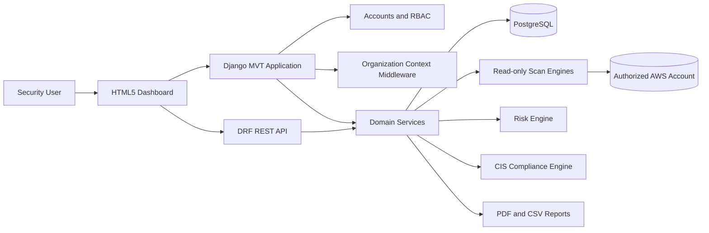
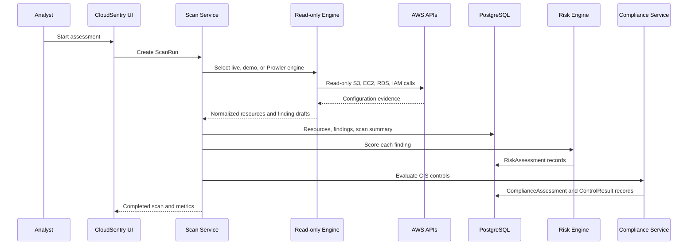

# CloudSentry Repository

CloudSentry is an enterprise-grade Cloud Security Posture Management platform delivered as a complete Django application inside [`clous-sentry/`](./clous-sentry/).

This repository is organized for professional handover: product documentation, architecture diagrams, database dictionaries, deployment commands, operational settings, and tests are all included.

## Repository contents

| Path | Purpose |
| --- | --- |
| `clous-sentry/` | Complete Django project source, templates, static assets, API, docs, and tests. |
| `clous-sentry/README.md` | Full product README with setup, architecture, database schema, commands, and operational notes. |
| `clous-sentry/docs/` | Architecture, ER diagram, deployment, and API reference documents. |
| `clous-sentry/LICENSE` | MIT license issued in the name of Njbalamani. |
| `LICENSE` | Repository-level MIT license issued in the name of Njbalamani. |

## Product summary

| Area | Implementation |
| --- | --- |
| Product name | CloudSentry — AI-Powered Cloud Security Posture Management Platform |
| Backend | Django 5, Django REST Framework, PostgreSQL |
| Frontend | Django MVT templates, custom CSS, JavaScript, Chart.js, Three.js |
| Cloud integration | Boto3 read-only AWS assessment engine, optional Prowler adapter |
| Security analytics | Rule engine, IAM least-privilege analyzer, CIS control mapping |
| Risk scoring | scikit-learn hybrid model with optional Gemini explanations |
| Reporting | PDF and CSV evidence exports with `reportlab` |
| Access control | Organization-scoped RBAC with owner, admin, analyst, and viewer roles |
| Demo safety | Synthetic records explicitly labelled with `is_demo=True` |
| Deployment | Local development, Docker Compose, Gunicorn, WhiteNoise |

## High-level architecture



## Scan workflow



## Repository structure

```text
Cloud-Sentry/
├── LICENSE
├── README.md
└── clous-sentry/
    ├── .dockerignore
    ├── .env.example
    ├── .github/
    │   └── workflows/
    │       └── ci.yml
    ├── .gitignore
    ├── Dockerfile
    ├── LICENSE
    ├── README.md
    ├── docker-compose.yml
    ├── manage.py
    ├── pyproject.toml
    ├── requirements.txt
    ├── accounts/
    │   ├── migrations/
    │   ├── tests/
    │   ├── admin.py
    │   ├── apps.py
    │   ├── forms.py
    │   ├── models.py
    │   ├── permissions.py
    │   ├── urls.py
    │   └── views.py
    ├── organizations/
    │   ├── migrations/
    │   ├── context_processors.py
    │   ├── forms.py
    │   ├── middleware.py
    │   ├── models.py
    │   ├── services.py
    │   ├── urls.py
    │   └── views.py
    ├── cloud_accounts/
    │   ├── api.py
    │   ├── forms.py
    │   ├── models.py
    │   ├── serializers.py
    │   ├── services.py
    │   ├── urls.py
    │   └── views.py
    ├── cloud_scanner/
    │   ├── engines/
    │   │   ├── aws.py
    │   │   ├── base.py
    │   │   ├── demo.py
    │   │   └── prowler.py
    │   ├── management/commands/
    │   │   ├── seed_demo_data.py
    │   │   └── seed_rules.py
    │   ├── api.py
    │   ├── forms.py
    │   ├── models.py
    │   ├── rules.py
    │   ├── services.py
    │   ├── urls.py
    │   └── views.py
    ├── iam_analyzer/
    │   ├── analyzer.py
    │   ├── api.py
    │   ├── models.py
    │   ├── services.py
    │   └── views.py
    ├── risk_engine/
    │   ├── api.py
    │   ├── engine.py
    │   ├── models.py
    │   └── views.py
    ├── compliance/
    │   ├── controls.py
    │   ├── service.py
    │   ├── api.py
    │   ├── models.py
    │   └── views.py
    ├── reports/
    │   ├── api.py
    │   ├── forms.py
    │   ├── models.py
    │   ├── services.py
    │   └── views.py
    ├── dashboard/
    │   ├── api.py
    │   ├── api_urls.py
    │   ├── services.py
    │   └── views.py
    ├── config/
    │   ├── api.py
    │   ├── asgi.py
    │   ├── error_views.py
    │   ├── exception_handler.py
    │   ├── settings.py
    │   ├── urls.py
    │   └── wsgi.py
    ├── templates/
    │   ├── auth/
    │   ├── cloud_accounts/
    │   ├── cloud_scanner/
    │   ├── compliance/
    │   ├── components/
    │   ├── dashboard/
    │   ├── errors/
    │   ├── iam_analyzer/
    │   ├── organizations/
    │   ├── reports/
    │   ├── risk_engine/
    │   └── base.html
    ├── static/
    │   ├── css/main.css
    │   └── js/
    │       ├── charts.js
    │       ├── main.js
    │       └── topology.js
    ├── docs/
    │   ├── api.md
    │   ├── architecture.md
    │   ├── deployment.md
    │   └── er-diagram.md
    ├── media/
    │   └── .gitkeep
    └── tests/
        ├── __init__.py
        └── test_platform.py
```

## Application module reference

| Module | Responsibility | Key models or components |
| --- | --- | --- |
| `accounts` | Authentication, custom user, profiles, login lockout, RBAC helpers | `User`, `LoginAttempt`, `OrganizationMemberRequiredMixin` |
| `organizations` | Tenants, active organization context, memberships | `Organization`, `OrganizationMembership` |
| `cloud_accounts` | Cloud account registry and encrypted credentials | `CloudAccount`, `CloudResource` |
| `cloud_scanner` | Rules, scans, findings, reviews, scan engines | `ScanRule`, `ScanRun`, `Finding`, `RemediationReview` |
| `iam_analyzer` | IAM policy analysis and least-privilege findings | `IAMAnalysis` |
| `risk_engine` | Hybrid risk scoring and explainability | `RiskAssessment` |
| `compliance` | CIS controls, assessments, and control results | `ComplianceControl`, `ComplianceAssessment`, `ControlResult` |
| `reports` | PDF and CSV report generation | `Report`, `ReportService` |
| `dashboard` | Metrics, topology, charts, dashboard API | `get_metrics`, `get_topology` |
| `config` | Settings, routing, API schema, error handling | `settings.py`, `urls.py`, `api.py` |

## Database table index

Full column-level documentation is maintained in `clous-sentry/README.md`.

| Database table | Domain | Primary purpose |
| --- | --- | --- |
| `accounts_user` | Identity | Custom user with platform roles and MFA flag |
| `accounts_loginattempt` | Security | Failed and successful sign-in audit records |
| `organizations_organization` | Tenancy | Tenant workspace and slug |
| `organizations_organizationmembership` | Access control | User role assignment per tenant |
| `cloud_accounts_cloudaccount` | Cloud integration | AWS account and encrypted credential metadata |
| `cloud_accounts_cloudresource` | Inventory | Discovered cloud resources and risk level |
| `cloud_scanner_scanrule` | Rules | Security rule catalog with remediation guidance |
| `cloud_scanner_scanrun` | Assessment | Scan lifecycle, counters, and summary |
| `cloud_scanner_finding` | Findings | Misconfiguration evidence, severity, status, risk score |
| `cloud_scanner_remediationreview` | Governance | Advisory remediation approvals and notes |
| `iam_analyzer_iamanalysis` | IAM | Policy document analysis and recommendations |
| `risk_engine_riskassessment` | Risk | Model score, factors, explanation, and source |
| `compliance_compliancecontrol` | Compliance | CIS control catalog |
| `compliance_complianceassessment` | Compliance | Tenant assessment score and counts |
| `compliance_controlresult` | Compliance | Per-control pass, fail, or not-applicable result |
| `reports_report` | Reporting | Generated PDF or CSV report metadata |

Django framework tables for sessions, permissions, content types, and REST tokens are also created by migrations.

## First-time setup

```powershell
cd clous-sentry
python -m venv .venv
.\.venv\Scripts\python.exe -m pip install --upgrade pip
.\.venv\Scripts\python.exe -m pip install -r requirements.txt
Copy-Item .env.example .env
```

Generate required values:

```powershell
.\.venv\Scripts\python.exe -c "from django.core.management.utils import get_random_secret_key; print(get_random_secret_key())"
.\.venv\Scripts\python.exe -c "from cryptography.fernet import Fernet; print(Fernet.generate_key().decode())"
```

Initialize the database:

```powershell
$env:TESTING='1'
.\.venv\Scripts\python.exe manage.py migrate
.\.venv\Scripts\python.exe manage.py seed_rules
.\.venv\Scripts\python.exe manage.py seed_controls
.\.venv\Scripts\python.exe manage.py runserver
```

Open the application, register the first user, and the platform will create the first organization with an owner membership.

## Docker deployment

```powershell
cd clous-sentry
Copy-Item .env.example .env
docker compose up --build
```

The compose stack starts PostgreSQL, applies migrations, seeds rules and controls, collects static files, and runs the application with Gunicorn.

## Verification commands

```powershell
cd clous-sentry
$env:TESTING='1'
.\.venv\Scripts\python.exe manage.py check
.\.venv\Scripts\python.exe manage.py makemigrations --check --dry-run
.\.venv\Scripts\python.exe manage.py test tests -v 2
.\.venv\Scripts\python.exe -m ruff check .
```

## License

MIT License. Copyright (c) 2026 Njbalamani. See [`LICENSE`](./LICENSE) and [`clous-sentry/LICENSE`](./clous-sentry/LICENSE).
