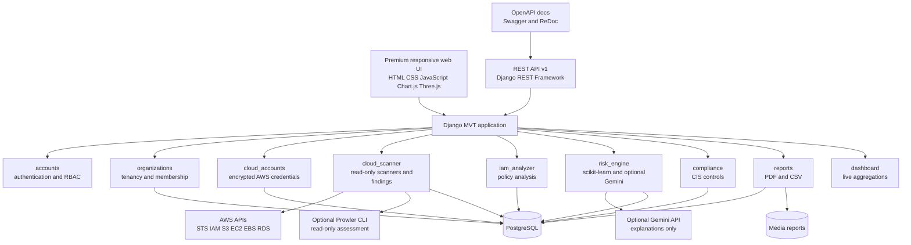
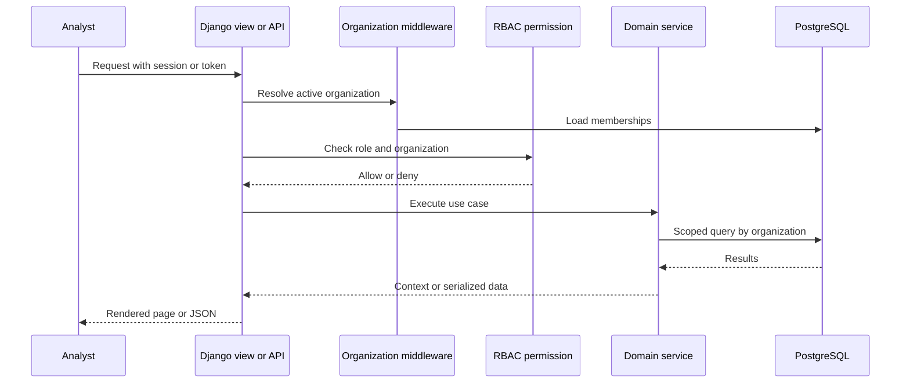
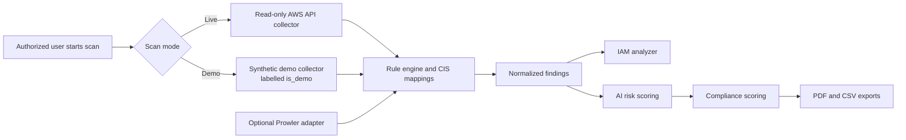
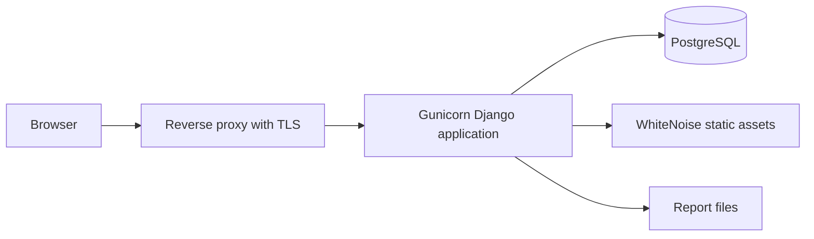

# CloudSentry Architecture

## System overview

## Request and tenancy flow

## Scanning flow

## Security controls

- All cloud scanning uses read-only AWS APIs. The platform never calls write APIs.
- Credentials are encrypted at rest with Fernet using `FIELD_ENCRYPTION_KEY` and are never serialized to templates, API responses, or logs.
- Organization scoping is enforced in permissions and querysets.
- Remediation is advisory only. Cloud changes require explicit out-of-band approval by an administrator.
- Demo data is generated only when explicitly requested and is always marked as synthetic.
- Dashboard metrics are calculated from database records at request time.

## Deployment topology

