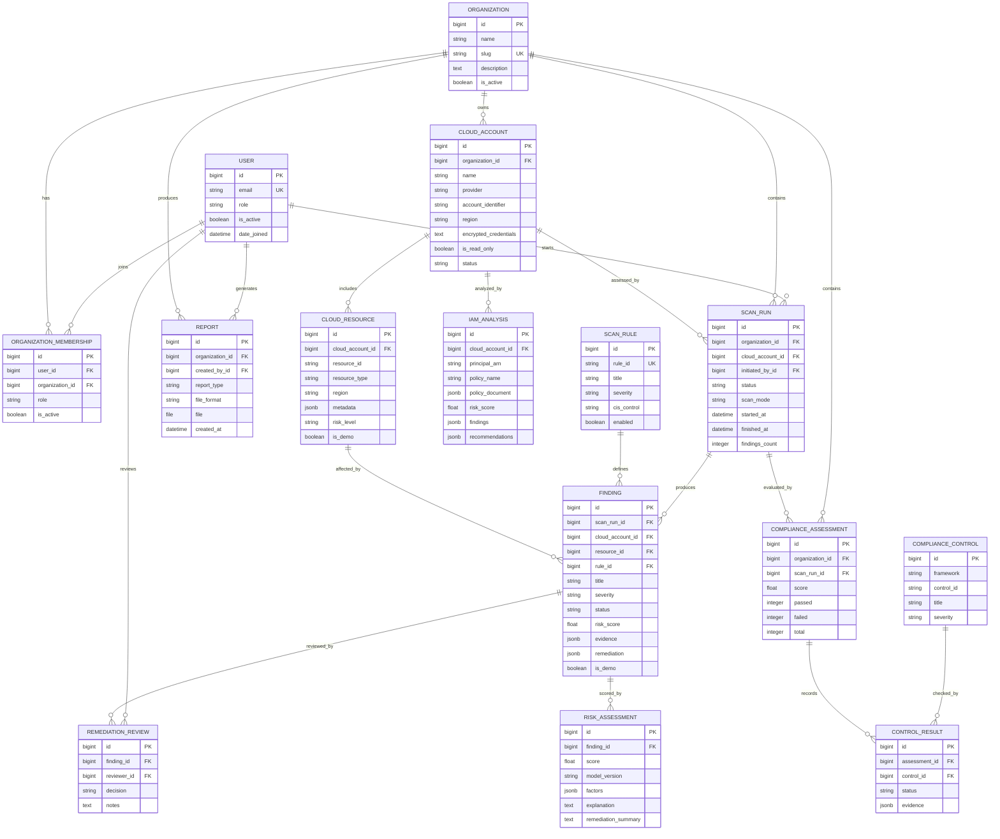

# CloudSentry Database ER Diagram

## Tenancy and data integrity rules

- Every tenant-owned record has a direct or indirect `organization_id`.
- `CloudResource.resource_id` is unique per cloud account.
- `Finding.evidence` and `Finding.remediation` are JSON documents validated by the service layer.
- Risk assessments are immutable once created.
- Reports are linked to the organization that generated them and stored under `media/reports/`.
- All demo-created records set `is_demo=True` so they can be identified and excluded.
