# CLOUDSENTRY

**AI-Powered Cloud Security Posture Management Platform**

| Document item | Detail |
| --- | --- |
| Application folder | `clous-sentry/` |
| Repository | `Njbalamani/Cloud-Sentry` |
| Document date | 24/11/2026 |
| Document type | Complete application README |
| Primary audience | Developers, administrators, security engineers, reviewers |
| Stack | Django 5, Django REST Framework, PostgreSQL |
| License | MIT License, Copyright (c) 2026 Njbalamani |

CloudSentry is a professional Cloud Security Posture Management platform for organisation-scoped cloud account management, read-only AWS assessments, IAM least-privilege analysis, CIS compliance evaluation, AI-assisted risk scoring, interactive visualisation, and PDF or CSV reporting.

---

## Table of contents

| No. | Section | What it contains |
| --- | --- | --- |
| 1 | [Product overview](#1-product-overview) | Purpose, capabilities, product identity, and security principles |
| 2 | [Architecture](#2-architecture) | Layered architecture, runtime topology, request flow, and design decisions |
| 3 | [Technology stack](#3-technology-stack) | Framework, database, frontend, cloud, reporting, and quality tooling |
| 4 | [Project structure](#4-project-structure) | Full tree, structure diagram, package ownership, and file conventions |
| 5 | [Workflows](#5-workflows) | Provisioning, cloud connection, scanning, risk, compliance, reports, governance |
| 6 | [Installation and configuration](#6-installation-and-configuration) | Prerequisites, setup steps, environment variables, and secrets |
| 7 | [Command reference](#7-command-reference) | Development, database, demo, reporting, quality, and production commands |
| 8 | [Routes and API](#8-routes-and-api) | UI routes, REST endpoints, API authentication, and error format |
| 9 | [Database](#9-database) | ER diagram, migration map, and column-level table dictionary |
| 10 | [Dashboard and reporting](#10-dashboard-and-reporting) | Metric definitions, topology model, and report types |
| 11 | [Security and compliance](#11-security-and-compliance) | Rules, CIS controls, IAM checks, and integrity rules |
| 12 | [Testing and quality](#12-testing-and-quality) | Verification commands, coverage areas, and CI workflow |
| 13 | [Deployment](#13-deployment) | Production checklist, Docker, Gunicorn, backup, and troubleshooting |
| 14 | [Documentation index](#14-documentation-index) | Links to all detailed documents |
| 15 | [License](#15-license) | License statement |

---

## 1. Product overview

### 1.1 Purpose

| Problem | CloudSentry response |
| --- | --- |
| Cloud posture data is scattered across separate AWS services | Normalises S3, EC2, RDS, and IAM evidence into one model |
| Misconfigurations are difficult to prioritise | Combines rule severity, evidence, and local risk scoring |
| Compliance evidence is manual | Maps findings to CIS AWS Foundations Benchmark v2.0 controls |
| Demo data can be confused with live data | Labels synthetic records with `is_demo` and `synthetic_data` |
| Multi-tenant access needs strict isolation | Filters all domain data by active organisation |
| Security findings need evidence export | Generates PDF and CSV reports from scoped database records |

### 1.2 Capability matrix

| Capability | User outcome | Main components |
| --- | --- | --- |
| Organisation workspaces | Separate tenant data and memberships | `Organization`, `OrganizationMembership`, middleware |
| Role-based access | Controlled actions for owner, admin, analyst, and viewer | `accounts/permissions.py` |
| Secure cloud onboarding | Encrypted credentials and read-only verification | `CloudAccount`, `cloud_accounts/services.py` |
| Rule-based scanning | Repeatable security evaluation | `ScanRule`, `cloud_scanner/rules.py` |
| Findings management | Evidence-led investigation and status tracking | `Finding`, scan views, REST API |
| IAM analysis | Least-privilege recommendations for policies | `IAMAnalysis`, `iam_analyzer/analyzer.py` |
| Risk scoring | Ranked findings with score, band, factors, and explanation | `RiskAssessment`, `risk_engine/engine.py` |
| Compliance | CIS control score and per-control evidence | `ComplianceAssessment`, `ControlResult` |
| Dashboard | Database-derived security metrics and topology | `dashboard/services.py`, Chart.js, Three.js |
| Reporting | Professional PDF and CSV evidence packages | `Report`, `reports/services.py` |

### 1.3 Product identity

| Item | Detail |
| --- | --- |
| Product name | CLOUDSENTRY |
| Product type | AI-Powered Cloud Security Posture Management Platform |
| Application root | `clous-sentry/` |
| API schema | `/api/schema/` |
| API documentation | `/api/docs/` and `/api/redoc/` |
| Default local URL | `http://localhost:8000` |
| Demo mode | Enabled by default through `DEMO_MODE=True` |
| Cloud write operations | Disabled by design |

### 1.4 Security principles

| Principle | Implementation |
| --- | --- |
| Read-only by design | Live AWS scanning uses read-only APIs and never modifies cloud resources. |
| Explicit synthetic data | Demo resources, findings, scans, IAM records, and reports are labelled. |
| Encrypted credentials | Cloud credentials are encrypted with Fernet before storage. |
| Secret redaction | Credentials are excluded from UI pages and read serializers. |
| Tenant isolation | Domain querysets are filtered by the active organisation. |
| Role-based control | UI and API actions enforce minimum roles. |
| Advisory remediation | Remediation decisions are stored as guidance only. |
| Secure defaults | Security headers, secure cookies, CSRF protection, and production secret validation are enabled. |

---

## 2. Architecture

### 2.1 Layered architecture

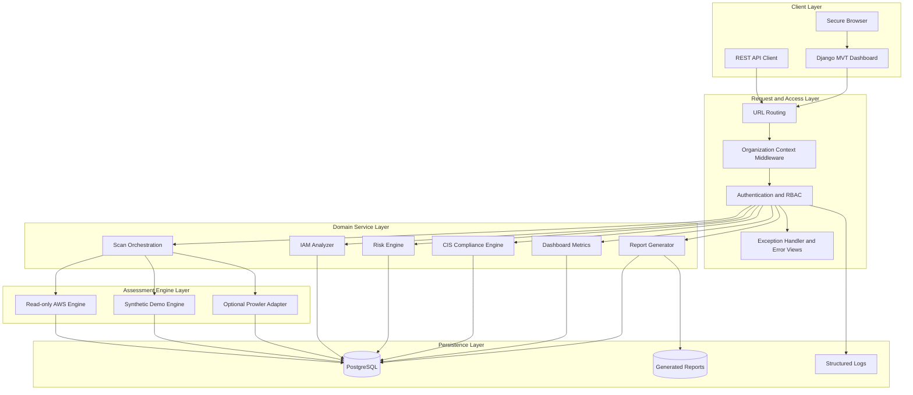

### 2.2 Runtime topology

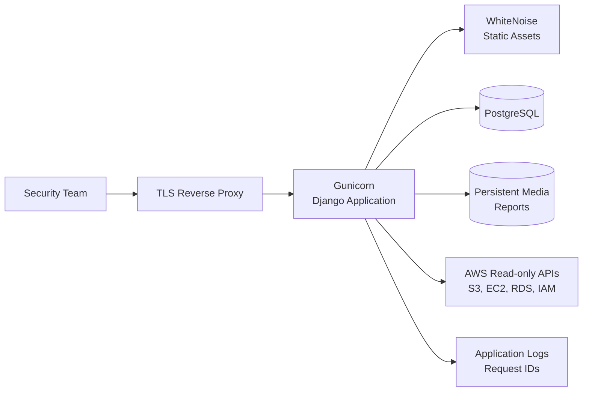

| Runtime component | Responsibility | Production note |
| --- | --- | --- |
| TLS reverse proxy | Terminates HTTPS and forwards requests | Required in production |
| Gunicorn | Serves the WSGI application | Recommended worker count is 3 or more |
| WhiteNoise | Serves compressed static assets | Runs inside the application process |
| PostgreSQL | Stores all application data | Use managed backups and monitoring |
| Media volume | Stores generated reports | Must be persistent |
| AWS APIs | Provides read-only configuration evidence | Use least-privilege IAM credentials |

### 2.3 Request and tenancy flow

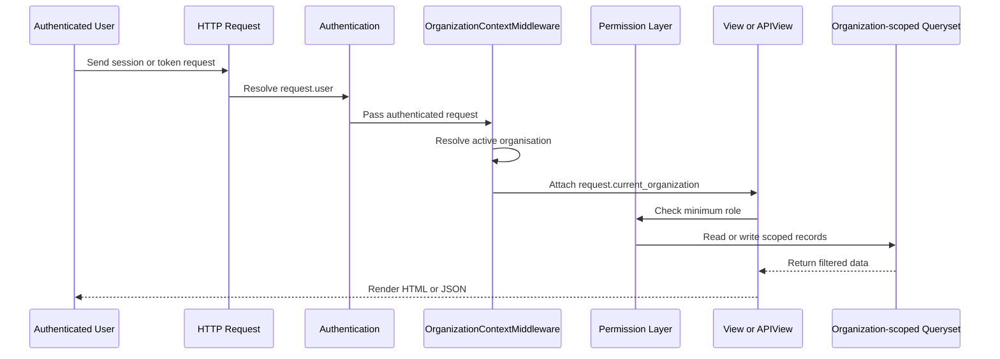

| Stage | Component | Security outcome |
| --- | --- | --- |
| 1 | Authentication middleware | Request has a resolved user |
| 2 | Organisation middleware | Request has an active tenant |
| 3 | Permission helpers | Action is allowed only for the required role |
| 4 | Service querysets | Data access is scoped to the tenant |
| 5 | Exception handler | Errors include a request ID for tracing |

### 2.4 Architecture decisions

| Decision | Reason |
| --- | --- |
| Django MVT plus DRF | Supports both premium HTML dashboards and machine-readable APIs from one domain model. |
| Organisation middleware | Keeps tenant context explicit for every request. |
| Service layer | Keeps views thin and business rules reusable from UI and API. |
| PostgreSQL in production | Provides relational integrity, JSON fields, and mature operational tooling. |
| SQLite only for tests | Makes automated tests fast and isolated without changing production storage. |
| Read-only engines | Prevents the platform from changing assessed cloud resources. |
| Local risk model | Core scoring works without external AI services. |
| Optional Gemini | Enhances explanations only when explicitly enabled. |
| Report media on disk | Keeps generated files simple, portable, and mounted in Docker. |
| DRF Spectacular | Provides live OpenAPI schema and interactive API documentation. |

---

## 3. Technology stack

| Layer | Technology | Usage |
| --- | --- | --- |
| Language | Python 3.12 | Backend implementation |
| Web framework | Django 5 | MVT application, ORM, migrations, auth, admin |
| API | Django REST Framework | REST API, serializers, routers, permissions |
| API schema | drf-spectacular | OpenAPI schema, Swagger UI, ReDoc |
| Database | PostgreSQL | Production data store |
| Test database | SQLite in-memory | Automated tests with `TESTING=True` |
| Frontend | HTML5, CSS3, JavaScript | Custom premium UI without Bootstrap |
| Visualisation | Chart.js and Three.js | Metrics charts and cloud topology graph |
| Cloud SDK | Boto3 | Read-only AWS assessment calls |
| External scanner | Prowler | Optional adapter mode |
| Risk engine | scikit-learn | Local hybrid risk scoring |
| Optional AI | Gemini API | Optional risk explanation enrichment |
| Reporting | ReportLab and CSV | PDF and CSV evidence packages |
| Encryption | cryptography Fernet | Credential encryption at rest |
| Static files | WhiteNoise | Static asset serving and compression |
| WSGI server | Gunicorn | Production application server |
| Configuration | python-decouple | Environment-based settings |
| Quality | Ruff and Django tests | Linting and automated verification |

---

## 4. Project structure

### 4.1 Full project tree

```text
clous-sentry/
├── .dockerignore                  Docker build exclusions
├── .env.example                   Environment variable template
├── .github/
│   └── workflows/
│       └── ci.yml                 Django checks, tests, and Ruff workflow
├── .gitignore                     Git exclusion rules
├── Dockerfile                     Production container image
├── LICENSE                        MIT license in Njbalamani name
├── README.md                      Full application documentation
├── docker-compose.yml             PostgreSQL plus web service stack
├── manage.py                      Django management entry point
├── pyproject.toml                 Ruff and pytest configuration
├── requirements.txt               Python dependency manifest
├── accounts/
│   ├── migrations/                User and login attempt migrations
│   ├── tests/                     Application test package
│   ├── admin.py                   Admin registrations
│   ├── apps.py                    App configuration
│   ├── forms.py                   Login, registration, and profile forms
│   ├── models.py                  User and LoginAttempt models
│   ├── permissions.py             RBAC helpers and API permissions
│   ├── urls.py                    Accounts routes
│   └── views.py                   Login, register, logout, profile views
├── organizations/
│   ├── migrations/                Tenant migrations
│   ├── api.py                     Organisation and membership API
│   ├── context_processors.py      Active organisation template context
│   ├── forms.py                   Organisation and member forms
│   ├── middleware.py              Active organisation resolution
│   ├── models.py                  Organisation and membership models
│   ├── serializers.py             API serializers
│   ├── services.py                Organisation creation services
│   ├── urls.py                    Organisation routes
│   └── views.py                   Organisation UI views
├── cloud_accounts/
│   ├── migrations/                Cloud account migrations
│   ├── api.py                     Cloud account and resource viewsets
│   ├── forms.py                   Secure account connection form
│   ├── models.py                  CloudAccount and CloudResource models
│   ├── serializers.py             API serializers
│   ├── services.py                Boto3 session and verification
│   ├── urls.py                    Cloud account routes
│   └── views.py                   Account UI and connection test views
├── cloud_scanner/
│   ├── engines/
│   │   ├── aws.py                 Read-only AWS assessment engine
│   │   ├── base.py                Scanner interfaces and finding drafts
│   │   ├── demo.py                Synthetic demo scan engine
│   │   └── prowler.py             Optional Prowler adapter
│   ├── management/commands/
│   │   ├── seed_demo_data.py      Synthetic demo data seeder
│   │   └── seed_rules.py          Security rule seeder
│   ├── migrations/                Scanner migrations
│   ├── api.py                     Scan, finding, and review viewsets
│   ├── forms.py                   Scan, filter, and review forms
│   ├── models.py                  ScanRule, ScanRun, Finding, Review models
│   ├── rules.py                   Built-in rule catalogue
│   ├── services.py                Scan orchestration service
│   ├── urls.py                    Scanner routes
│   └── views.py                   Operations and finding UI views
├── iam_analyzer/
│   ├── migrations/                IAM analysis migrations
│   ├── analyzer.py                Policy analysis rules
│   ├── api.py                     IAM API viewset
│   ├── models.py                  IAMAnalysis model
│   ├── services.py                IAM collection service
│   ├── urls.py                    IAM routes
│   └── views.py                   IAM UI views
├── risk_engine/
│   ├── migrations/                Risk migrations
│   ├── api.py                     Risk API viewset
│   ├── engine.py                  Model training, scoring, explanations
│   ├── models.py                  RiskAssessment model
│   ├── serializers.py             API serializers
│   ├── urls.py                    Risk routes
│   └── views.py                   Risk UI views
├── compliance/
│   ├── management/commands/
│   │   └── seed_controls.py       CIS control seeder
│   ├── migrations/                Compliance migrations
│   ├── api.py                     Compliance API viewsets
│   ├── controls.py                CIS control catalogue
│   ├── models.py                  Compliance models
│   ├── serializers.py             API serializers
│   ├── service.py                 Control evaluation service
│   ├── urls.py                    Compliance routes
│   └── views.py                   Compliance UI views
├── reports/
│   ├── migrations/                Report migrations
│   ├── api.py                     Report API and download endpoints
│   ├── forms.py                   Report generation form
│   ├── models.py                  Report model
│   ├── serializers.py             API serializers
│   ├── services.py                PDF and CSV generation services
│   ├── urls.py                    Report routes
│   └── views.py                   Report UI and download views
├── dashboard/
│   ├── api.py                     Metrics and topology API views
│   ├── api_urls.py                Dashboard API routes
│   ├── services.py                Database-derived metrics and topology
│   ├── urls.py                    Dashboard route
│   └── views.py                   Dashboard view and landing redirect
├── config/
│   ├── api.py                     DRF router registrations
│   ├── asgi.py                    ASGI entry point
│   ├── error_views.py             Custom 403, 404, and 500 handlers
│   ├── exception_handler.py       Consistent API error envelope
│   ├── settings.py                Central settings and security config
│   ├── urls.py                    Root URL configuration
│   └── wsgi.py                    WSGI entry point
├── templates/
│   ├── auth/                      Login, register, profile templates
│   ├── cloud_accounts/            Account list, connect, detail, resources
│   ├── cloud_scanner/             Operations, scans, findings
│   ├── compliance/                Compliance overview and detail
│   ├── components/                Reusable UI components
│   ├── dashboard/                 Main dashboard page
│   ├── errors/                    403, 404, and 500 pages
│   ├── iam_analyzer/              IAM list, detail, analyze pages
│   ├── organizations/             Organisation and member pages
│   ├── reports/                   Report list and generation pages
│   ├── risk_engine/               Risk list and detail pages
│   └── base.html                  Main application shell
├── static/
│   ├── css/main.css               Premium design system
│   └── js/
│       ├── charts.js              Chart.js rendering
│       ├── main.js                General UI behaviour
│       └── topology.js            Three.js topology renderer
├── docs/
│   ├── api.md                     API reference
│   ├── architecture.md            Architecture and deployment topology
│   ├── deployment.md              Production deployment guide
│   └── er-diagram.md              Entity relationship documentation
├── media/
│   └── .gitkeep                   Media directory marker
├── staticfiles/
│   └── .gitkeep                   Collected static directory marker
└── tests/
    ├── __init__.py                Test package marker
    └── test_platform.py           Core integration test suite
```

### 4.2 Django module structure diagram

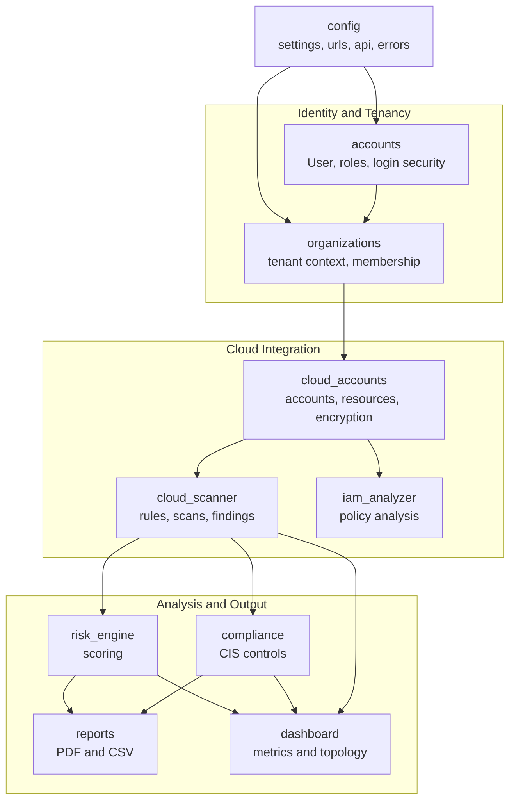

### 4.3 Package responsibility matrix

| Package | Responsibility | Key files |
| --- | --- | --- |
| `accounts` | Authentication, custom user, roles, login lockout | `models.py`, `permissions.py`, `views.py` |
| `organizations` | Tenant workspace and active organisation context | `middleware.py`, `services.py`, `models.py` |
| `cloud_accounts` | Cloud account registry and encrypted credentials | `models.py`, `services.py`, `forms.py` |
| `cloud_scanner` | Scan lifecycle and finding evidence | `services.py`, `rules.py`, `engines/`, `models.py` |
| `iam_analyzer` | Policy statement analysis and recommendations | `analyzer.py`, `services.py`, `models.py` |
| `risk_engine` | Hybrid scoring and risk explanations | `engine.py`, `models.py` |
| `compliance` | CIS control mapping and evaluation | `controls.py`, `service.py`, `models.py` |
| `reports` | Evidence export | `services.py`, `models.py`, `api.py` |
| `dashboard` | Metrics, topology, and visualisation data | `services.py`, `api.py`, `views.py` |
| `config` | Application configuration and API schema | `settings.py`, `urls.py`, `api.py` |
| `tests` | Cross-application integration verification | `test_platform.py` |

### 4.4 File convention table

| File name | Convention | Purpose |
| --- | --- | --- |
| `models.py` | Django model definitions | Persistent entities and constraints |
| `views.py` | MVT request handlers | HTML pages and form processing |
| `api.py` | DRF viewsets and API routes | REST endpoints |
| `serializers.py` | DRF serializers | API validation and output shaping |
| `services.py` | Domain logic | Reusable operations separate from views |
| `forms.py` | Django forms | HTML form validation |
| `urls.py` | URL patterns | Application route registration |
| `admin.py` | Admin registrations | Django admin configuration |
| `migrations/` | Generated schema migrations | Database evolution |
| `tests/` | Application-specific tests | Local app test package |

---

## 5. Workflows

### 5.1 Workflow index

| ID | Workflow | Diagram | Main result |
| --- | --- | --- | --- |
| WF-01 | Platform provisioning | [5.2](#52-platform-provisioning) | User, organisation, owner membership |
| WF-02 | Cloud account connection | [5.3](#53-cloud-account-connection) | Encrypted cloud account |
| WF-03 | Assessment lifecycle | [5.4](#54-assessment-lifecycle) | Scan run, resources, findings |
| WF-04 | Risk scoring | [5.5](#55-risk-scoring-workflow) | RiskAssessment records |
| WF-05 | Compliance evaluation | [5.6](#56-compliance-evaluation-workflow) | ComplianceAssessment records |
| WF-06 | Report generation | [5.7](#57-report-generation-workflow) | PDF or CSV evidence file |
| WF-07 | Governance review | [5.8](#58-governance-review-workflow) | Advisory remediation decision |
| WF-08 | Access control | [5.9](#59-access-control-workflow) | Role-checked request |

### 5.2 Platform provisioning

| Step | Actor | Action | Result |
| --- | --- | --- | --- |
| 1 | User | Opens registration form | Registration page |
| 2 | System | Validates password policy | Secure password accepted |
| 3 | System | Creates custom user | `accounts_user` row |
| 4 | System | Creates default organisation | `organizations_organization` row |
| 5 | System | Creates owner membership | Full tenant access for first user |
| 6 | User | Signs in | Dashboard with active organisation |

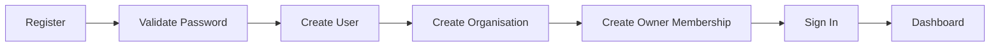

### 5.3 Cloud account connection

| Step | Actor | Action | Control |
| --- | --- | --- | --- |
| 1 | Administrator | Opens connect account page | Role checked |
| 2 | Administrator | Submits AWS account details | Organisation-scoped form |
| 3 | System | Verifies credential using read-only metadata call | No write permission requested |
| 4 | System | Encrypts credential payload | Fernet encryption |
| 5 | System | Saves cloud account | `is_read_only=True` |
| 6 | System | Enables scanning | `scan_enabled=True` |

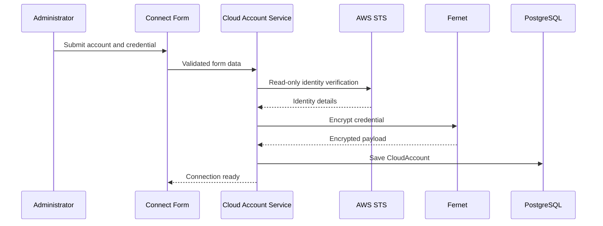

### 5.4 Assessment lifecycle

| Stage | Input | Processing | Output |
| --- | --- | --- | --- |
| Create | Cloud account and selected mode | Validate tenant and role | `ScanRun` |
| Collect | Authorized account or demo catalogue | Discover resources and configuration | `CloudResource` |
| Evaluate | Enabled rules | Apply rule logic to resource metadata | Finding drafts |
| Persist | Finding drafts | Attach evidence, severity, remediation | `Finding` records |
| Score | Findings | Run local hybrid risk model | `RiskAssessment` |
| Compliance | Findings and controls | Evaluate mapped CIS controls | `ControlResult` |
| Finish | Counters and summaries | Update scan status | Dashboard metrics |

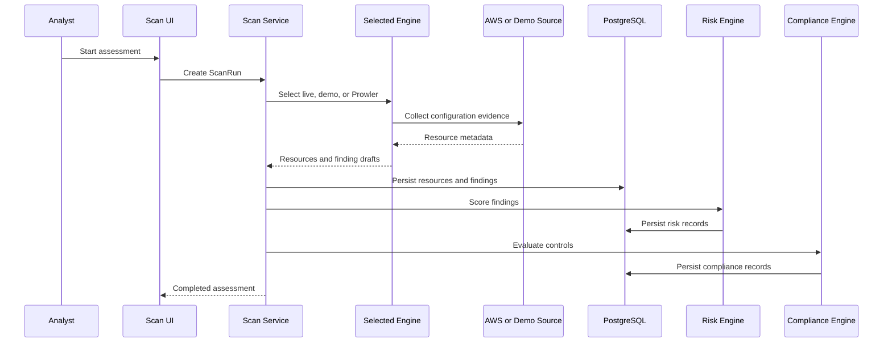

### 5.5 Risk scoring workflow

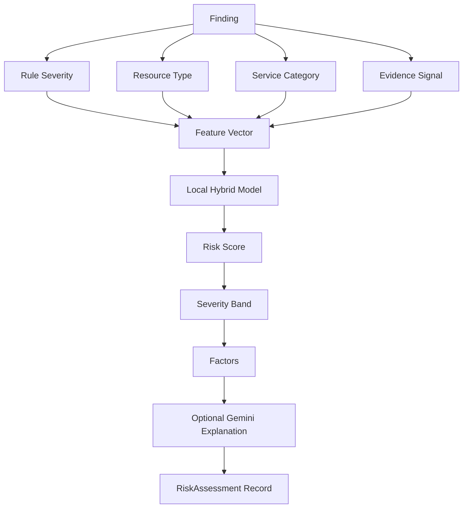

| Risk input | Source | Purpose |
| --- | --- | --- |
| Rule severity | `ScanRule.severity` | Baseline criticality |
| Resource context | `CloudResource.resource_type` | Adjusts blast-radius estimate |
| Service category | `ScanRule.category` | Adds domain context |
| Evidence signal | `Finding.evidence` | Captures concrete configuration proof |
| Optional AI | Gemini API | Adds human-readable explanation when enabled |

### 5.6 Compliance evaluation workflow

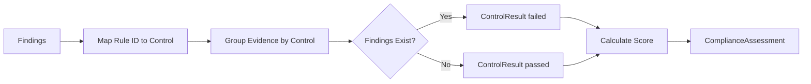

| Compliance field | Meaning |
| --- | --- |
| `score` | Percentage of evaluated controls that passed |
| `passed` | Number of passing controls |
| `failed` | Number of failing controls |
| `total` | Number of enabled controls evaluated |
| `summary` | Human-readable control result summary |

### 5.7 Report generation workflow

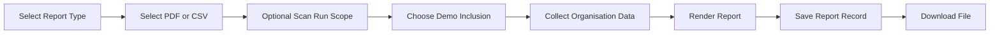

| Report input | Behaviour |
| --- | --- |
| Report type | Selects security assessment, findings, compliance, or IAM risk template |
| File format | Produces PDF or CSV |
| Assessment scope | Limits evidence to a selected `ScanRun` when provided |
| Include demo | Allows clearly labelled synthetic records when enabled |
| Organisation scope | Always restricted to the active tenant |

### 5.8 Governance review workflow

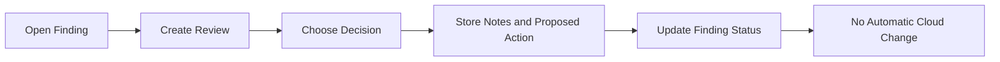

| Review field | Purpose |
| --- | --- |
| `decision` | Pending, approved, rejected, or note-only outcome |
| `notes` | Reviewer explanation |
| `proposed_action` | Advisory before and after configuration |
| `reviewed_at` | Governance timestamp |
| `reviewer` | Accountable reviewer |

### 5.9 Access control workflow

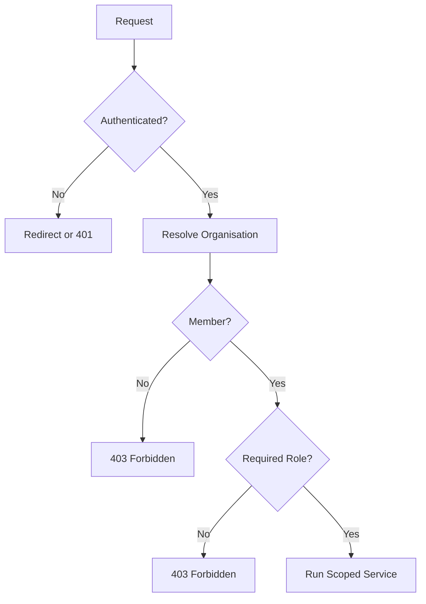

| Role | Typical permissions |
| --- | --- |
| Owner | Full tenant control, members, accounts, scans, reports |
| Administrator | Manage accounts, scans, findings, compliance, reports |
| Analyst | Run scans, review findings, generate reports |
| Viewer | Read dashboards, findings, compliance, and reports |

---

## 6. Installation and configuration

### 6.1 Prerequisites

| Requirement | Version or detail | Required for |
| --- | --- | --- |
| Python | 3.12 or compatible | All local and server deployments |
| pip | Latest recommended | Dependency installation |
| PostgreSQL | 14 or newer | Production and Docker deployment |
| Docker Desktop | Current stable release | Container deployment |
| AWS IAM credentials | Read-only policy | Live AWS assessments |
| Prowler binary | Optional | Prowler assessment mode |
| Gemini API key | Optional | AI explanation enrichment |

### 6.2 Local setup steps

| Step | Action | Command or detail |
| --- | --- | --- |
| 1 | Enter project folder | `cd clous-sentry` |
| 2 | Create virtual environment | `python -m venv .venv` |
| 3 | Upgrade pip | `.\.venv\Scripts\python.exe -m pip install --upgrade pip` |
| 4 | Install packages | `.\.venv\Scripts\python.exe -m pip install -r requirements.txt` |
| 5 | Create environment file | `Copy-Item .env.example .env` |
| 6 | Generate secrets | Use commands in section 6.5 |
| 7 | Enable local test database | `$env:TESTING='1'` |
| 8 | Apply migrations | `.\.venv\Scripts\python.exe manage.py migrate` |
| 9 | Seed rules | `.\.venv\Scripts\python.exe manage.py seed_rules` |
| 10 | Seed controls | `.\.venv\Scripts\python.exe manage.py seed_controls` |
| 11 | Start server | `.\.venv\Scripts\python.exe manage.py runserver` |

### 6.3 Docker setup steps

| Step | Command | Result |
| --- | --- | --- |
| 1 | `cd clous-sentry` | Enter project folder |
| 2 | `Copy-Item .env.example .env` | Create environment configuration |
| 3 | `docker compose up --build` | Build and start the stack |
| 4 | Open `http://localhost:8000` | Use the application |

### 6.4 Environment variables

| Variable | Required | Default | Description |
| --- | --- | --- | --- |
| `SECRET_KEY` | Production yes | Development key | Django signing key; production requires at least 50 characters |
| `DEBUG` | Yes | `True` | Must be `False` in production |
| `TESTING` | No | `False` | Uses in-memory SQLite when enabled |
| `ALLOWED_HOSTS` | Production yes | `localhost,127.0.0.1` | Comma-separated host allowlist |
| `CSRF_TRUSTED_ORIGINS` | Production yes | `http://localhost:8000` | Comma-separated CSRF origins |
| `CORS_ALLOWED_ORIGINS` | Optional | empty | Comma-separated browser API origins |
| `DATABASE_URL` | Production yes | local PostgreSQL URL | PostgreSQL connection string |
| `DEMO_MODE` | Yes | `True` | Enables labelled synthetic assessments |
| `ALLOW_PUBLIC_REGISTRATION` | Yes | `True` | Disable after first administrator is provisioned |
| `FIELD_ENCRYPTION_KEY` | Production yes | empty | Fernet key for credential encryption |
| `AI_EXPLANATIONS_ENABLED` | No | `False` | Enables optional Gemini explanation calls |
| `GEMINI_API_KEY` | Conditional | empty | Required only when AI explanations are enabled |
| `GEMINI_MODEL` | No | `gemini-1.5-flash` | Gemini model name |
| `PROWLER_BIN` | Conditional | empty | Required only for Prowler scan mode |
| `SCAN_TIMEOUT_SECONDS` | No | `300` | Timeout for external scan adapters |
| `AWS_DEFAULT_REGION` | No | `us-east-1` | Default AWS region |
| `LOG_LEVEL` | No | `INFO` | Application log level |

### 6.5 Generate secret values

```powershell
.\.venv\Scripts\python.exe -c "from django.core.management.utils import get_random_secret_key; print(get_random_secret_key())"
.\.venv\Scripts\python.exe -c "from cryptography.fernet import Fernet; print(Fernet.generate_key().decode())"
```

| Secret | Store in | Rotation guidance |
| --- | --- | --- |
| `SECRET_KEY` | `.env` or secret manager | Rotate with planned session invalidation |
| `FIELD_ENCRYPTION_KEY` | `.env` or secret manager | Keep stable while encrypted credentials exist |
| `GEMINI_API_KEY` | `.env` or secret manager | Rotate through provider console when needed |
| AWS credentials | Cloud account form or role assumption | Prefer short-lived role assumption where possible |

---

## 7. Command reference

| Purpose | Command |
| --- | --- |
| Start development server | `python manage.py runserver` |
| Apply migrations | `python manage.py migrate` |
| Create migrations | `python manage.py makemigrations` |
| Check migration drift | `python manage.py makemigrations --check --dry-run` |
| Run Django checks | `python manage.py check` |
| Seed security rules | `python manage.py seed_rules` |
| Seed CIS controls | `python manage.py seed_controls` |
| Seed demo data | `python manage.py seed_demo_data --organization-slug your-organization-slug` |
| Open Django shell | `python manage.py shell` |
| Collect static files | `python manage.py collectstatic --noinput` |
| Run tests | `python manage.py test tests -v 2` |
| Run linter | `python -m ruff check .` |
| Start Gunicorn | `gunicorn config.wsgi:application --bind 0.0.0.0:8000 --workers 3 --timeout 120` |

| Environment | Command prefix |
| --- | --- |
| Windows virtual environment | `.\.venv\Scripts\python.exe` |
| Linux or macOS virtual environment | `./.venv/bin/python` |
| Local SQLite/test mode | Set `TESTING=True` before running commands |

---

## 8. Routes and API

### 8.1 UI routes

| Route | Purpose |
| --- | --- |
| `/` | Landing redirect |
| `/accounts/register/` | User and organisation registration |
| `/accounts/login/` | Sign in |
| `/accounts/profile/` | Profile management |
| `/dashboard/` | Main security dashboard |
| `/organizations/` | Organisation list |
| `/organizations/create/` | Organisation creation |
| `/organizations/<slug>/members/` | Member management |
| `/cloud-accounts/` | Cloud account list |
| `/cloud-accounts/connect/` | Connect a cloud account |
| `/cloud-accounts/<id>/` | Cloud account detail |
| `/scans/` | Security operations |
| `/scans/start/` | Start assessment |
| `/scans/runs/` | Assessment history |
| `/scans/findings/` | Finding list |
| `/iam/` | IAM analysis list |
| `/risk/` | Risk assessment list |
| `/compliance/` | Compliance overview |
| `/reports/` | Report list |
| `/reports/generate/` | Generate report |

### 8.2 REST API endpoints

| Endpoint | Methods | Description |
| --- | --- | --- |
| `/api/v1/organizations/` | GET | Accessible organisations |
| `/api/v1/organization-members/` | GET | Active members |
| `/api/v1/cloud-accounts/` | GET, POST | Cloud accounts |
| `/api/v1/cloud-resources/` | GET | Discovered resources |
| `/api/v1/scan-runs/` | GET, POST | Assessments |
| `/api/v1/scan-runs/{id}/run/` | POST | Run assessment |
| `/api/v1/scan-runs/{id}/findings/` | GET | Findings for one assessment |
| `/api/v1/findings/` | GET | Organisation findings |
| `/api/v1/remediation-reviews/` | GET, POST | Advisory remediation reviews |
| `/api/v1/iam-analyses/` | GET | IAM analysis records |
| `/api/v1/risk-assessments/` | GET | Risk assessments |
| `/api/v1/compliance-assessments/` | GET | Compliance assessments |
| `/api/v1/compliance-controls/` | GET | CIS control catalogue |
| `/api/v1/reports/` | GET | Generated reports |
| `/api/v1/reports/generate/` | POST | Generate PDF or CSV report |
| `/api/v1/reports/{id}/download/` | GET | Download report |
| `/api/v1/dashboard/metrics/` | GET | Dashboard metrics |
| `/api/v1/dashboard/topology/` | GET | Cloud topology graph |

### 8.3 API documentation routes

| Route | Purpose |
| --- | --- |
| `/api/schema/` | OpenAPI schema |
| `/api/docs/` | Swagger UI |
| `/api/redoc/` | ReDoc |

### 8.4 API authentication and errors

| Item | Detail |
| --- | --- |
| Authentication | Session authentication and token authentication |
| Default permission | Authenticated user required |
| Pagination | Page-number pagination, 25 records per page |
| Schema | drf-spectacular AutoSchema |
| Error wrapper | `error.code`, `error.message`, `error.details`, `error.request_id` |

---

## 9. Database

### 9.1 Entity relationship diagram

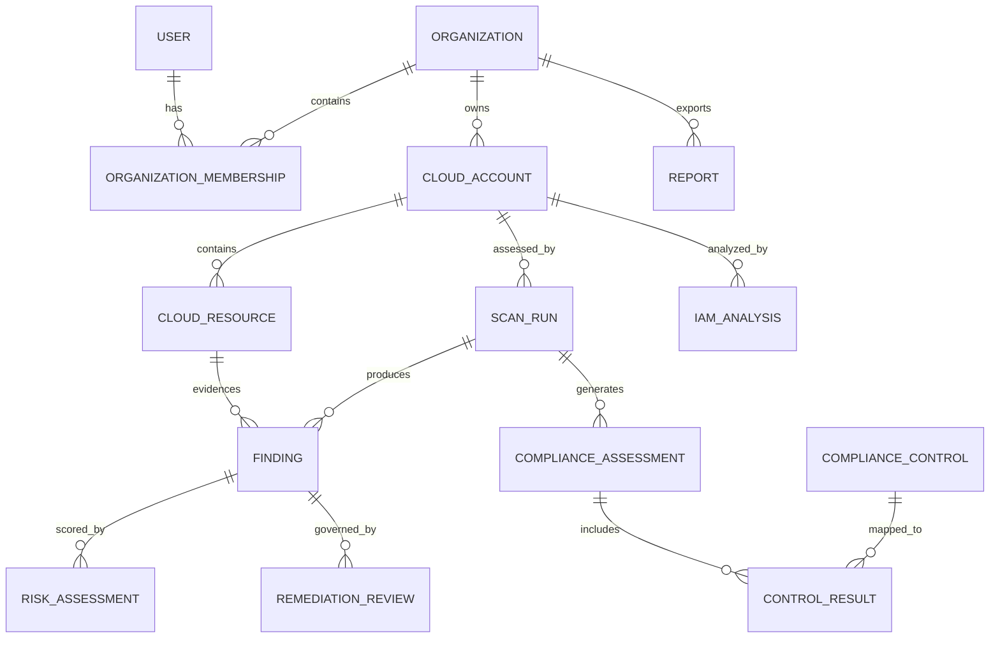

### 9.2 Migration map

| App | Migration | Purpose |
| --- | --- | --- |
| `accounts` | `0001_initial.py` | User and login attempt tables |
| `organizations` | `0001_initial.py` | Organisation and membership tables |
| `cloud_accounts` | `0001_initial.py` | Cloud account and resource tables |
| `cloud_scanner` | `0001_initial.py` | Rules, scans, findings, reviews |
| `cloud_scanner` | `0002_scanrun_updated_at.py` | Adds scan update timestamp used by scan finalisation |
| `iam_analyzer` | `0001_initial.py` | IAM analysis table |
| `risk_engine` | `0001_initial.py` | Risk assessment table |
| `compliance` | `0001_initial.py` | Controls, assessments, and results |
| `reports` | `0001_initial.py` | Report metadata table |

### 9.3 Table dictionary

The following tables document application-owned database columns. Django framework tables for sessions, permissions, content types, and REST tokens are also created by migrations.

#### `accounts_user`

| Column | Type | Null | Default | Relation |
| --- | --- | --- | --- | --- |
| `id` | BigAutoField | NO | — | — |
| `password` | CharField | NO | — | — |
| `last_login` | DateTimeField | YES | — | — |
| `is_superuser` | BooleanField | NO | `False` | — |
| `email` | CharField | NO | — | — |
| `full_name` | CharField | NO | — | — |
| `role` | CharField | NO | `analyst` | — |
| `mfa_enabled` | BooleanField | NO | `False` | — |
| `is_active` | BooleanField | NO | `True` | — |
| `is_staff` | BooleanField | NO | `False` | — |
| `date_joined` | DateTimeField | NO | `now` | — |
| `created_at` | DateTimeField | NO | auto | — |
| `updated_at` | DateTimeField | NO | auto | — |

#### `accounts_loginattempt`

| Column | Type | Null | Default | Relation |
| --- | --- | --- | --- | --- |
| `id` | BigAutoField | NO | — | — |
| `email` | CharField | NO | — | — |
| `ip_address` | GenericIPAddressField | YES | — | — |
| `success` | BooleanField | NO | `False` | — |
| `created_at` | DateTimeField | NO | auto | — |

#### `organizations_organization`

| Column | Type | Null | Default | Relation |
| --- | --- | --- | --- | --- |
| `id` | BigAutoField | NO | — | — |
| `name` | CharField | NO | — | — |
| `slug` | SlugField | NO | auto slug | — |
| `description` | TextField | NO | — | — |
| `is_active` | BooleanField | NO | `True` | — |
| `created_by_id` | ForeignKey | YES | — | `accounts_user` |
| `created_at` | DateTimeField | NO | auto | — |
| `updated_at` | DateTimeField | NO | auto | — |

#### `organizations_organizationmembership`

| Column | Type | Null | Default | Relation |
| --- | --- | --- | --- | --- |
| `id` | BigAutoField | NO | — | — |
| `user_id` | ForeignKey | NO | — | `accounts_user` |
| `organization_id` | ForeignKey | NO | — | `organizations_organization` |
| `role` | CharField | NO | `analyst` | — |
| `is_active` | BooleanField | NO | `True` | — |
| `joined_at` | DateTimeField | NO | auto | — |

#### `cloud_accounts_cloudaccount`

| Column | Type | Null | Default | Relation |
| --- | --- | --- | --- | --- |
| `id` | BigAutoField | NO | — | — |
| `organization_id` | ForeignKey | NO | — | `organizations_organization` |
| `name` | CharField | NO | — | — |
| `provider` | CharField | NO | `aws` | — |
| `account_identifier` | CharField | NO | — | — |
| `region` | CharField | NO | `us-east-1` | — |
| `credential_type` | CharField | NO | `assume_role` | — |
| `role_arn` | CharField | NO | — | — |
| `encrypted_credentials` | TextField | NO | — | — |
| `credential_version` | PositiveIntegerField | NO | `0` | — |
| `is_read_only` | BooleanField | NO | `True` | — |
| `scan_enabled` | BooleanField | NO | `True` | — |
| `status` | CharField | NO | `pending` | — |
| `notes` | TextField | NO | — | — |
| `last_checked_at` | DateTimeField | YES | — | — |
| `created_by_id` | ForeignKey | YES | — | `accounts_user` |
| `created_at` | DateTimeField | NO | auto | — |
| `updated_at` | DateTimeField | NO | auto | — |

#### `cloud_accounts_cloudresource`

| Column | Type | Null | Default | Relation |
| --- | --- | --- | --- | --- |
| `id` | BigAutoField | NO | — | — |
| `cloud_account_id` | ForeignKey | NO | — | `cloud_accounts_cloudaccount` |
| `resource_id` | CharField | NO | — | — |
| `resource_type` | CharField | NO | — | — |
| `name` | CharField | NO | — | — |
| `region` | CharField | NO | — | — |
| `metadata` | JSONField | NO | `{}` | — |
| `tags` | JSONField | NO | `{}` | — |
| `risk_level` | CharField | NO | `none` | — |
| `is_demo` | BooleanField | NO | `False` | — |
| `discovered_at` | DateTimeField | NO | auto | — |
| `last_seen_at` | DateTimeField | NO | auto | — |

#### `cloud_scanner_scanrule`

| Column | Type | Null | Default | Relation |
| --- | --- | --- | --- | --- |
| `id` | BigAutoField | NO | — | — |
| `rule_id` | CharField | NO | — | — |
| `title` | CharField | NO | — | — |
| `description` | TextField | NO | — | — |
| `provider` | CharField | NO | `aws` | — |
| `service` | CharField | NO | — | — |
| `category` | CharField | NO | — | — |
| `severity` | CharField | NO | `medium` | — |
| `cis_control` | CharField | NO | — | — |
| `benchmark` | CharField | NO | `CIS AWS Foundations v2.0` | — |
| `remediation` | JSONField | NO | `{}` | — |
| `enabled` | BooleanField | NO | `True` | — |
| `created_at` | DateTimeField | NO | auto | — |
| `updated_at` | DateTimeField | NO | auto | — |

#### `cloud_scanner_scanrun`

| Column | Type | Null | Default | Relation |
| --- | --- | --- | --- | --- |
| `id` | BigAutoField | NO | — | — |
| `organization_id` | ForeignKey | NO | — | `organizations_organization` |
| `cloud_account_id` | ForeignKey | NO | — | `cloud_accounts_cloudaccount` |
| `initiated_by_id` | ForeignKey | YES | — | `accounts_user` |
| `status` | CharField | NO | `pending` | — |
| `scan_mode` | CharField | NO | `live` | — |
| `started_at` | DateTimeField | NO | auto | — |
| `finished_at` | DateTimeField | YES | — | — |
| `updated_at` | DateTimeField | NO | auto | — |
| `resources_scanned` | PositiveIntegerField | NO | `0` | — |
| `findings_count` | PositiveIntegerField | NO | `0` | — |
| `summary` | JSONField | NO | `{}` | — |
| `error_message` | TextField | NO | — | — |

#### `cloud_scanner_finding`

| Column | Type | Null | Default | Relation |
| --- | --- | --- | --- | --- |
| `id` | BigAutoField | NO | — | — |
| `scan_run_id` | ForeignKey | NO | — | `cloud_scanner_scanrun` |
| `cloud_account_id` | ForeignKey | NO | — | `cloud_accounts_cloudaccount` |
| `resource_id` | ForeignKey | YES | — | `cloud_accounts_cloudresource` |
| `rule_id` | ForeignKey | YES | — | `cloud_scanner_scanrule` |
| `title` | CharField | NO | — | — |
| `description` | TextField | NO | — | — |
| `severity` | CharField | NO | `medium` | — |
| `status` | CharField | NO | `open` | — |
| `evidence` | JSONField | NO | `{}` | — |
| `remediation` | JSONField | NO | `{}` | — |
| `risk_score` | FloatField | NO | `0` | — |
| `is_demo` | BooleanField | NO | `False` | — |
| `created_at` | DateTimeField | NO | auto | — |
| `updated_at` | DateTimeField | NO | auto | — |

#### `cloud_scanner_remediationreview`

| Column | Type | Null | Default | Relation |
| --- | --- | --- | --- | --- |
| `id` | BigAutoField | NO | — | — |
| `finding_id` | ForeignKey | NO | — | `cloud_scanner_finding` |
| `reviewer_id` | ForeignKey | YES | — | `accounts_user` |
| `decision` | CharField | NO | `pending` | — |
| `notes` | TextField | NO | — | — |
| `proposed_action` | JSONField | NO | `{}` | — |
| `reviewed_at` | DateTimeField | NO | auto | — |

#### `iam_analyzer_iamanalysis`

| Column | Type | Null | Default | Relation |
| --- | --- | --- | --- | --- |
| `id` | BigAutoField | NO | — | — |
| `cloud_account_id` | ForeignKey | NO | — | `cloud_accounts_cloudaccount` |
| `scan_run_id` | ForeignKey | YES | — | `cloud_scanner_scanrun` |
| `principal_arn` | CharField | NO | — | — |
| `policy_name` | CharField | NO | — | — |
| `policy_document` | JSONField | NO | `{}` | — |
| `findings` | JSONField | NO | `[]` | — |
| `recommendations` | JSONField | NO | `[]` | — |
| `risk_score` | FloatField | NO | `0` | — |
| `is_demo` | BooleanField | NO | `False` | — |
| `analyzed_at` | DateTimeField | NO | auto | — |
| `analyzed_by_id` | ForeignKey | YES | — | `accounts_user` |

#### `risk_engine_riskassessment`

| Column | Type | Null | Default | Relation |
| --- | --- | --- | --- | --- |
| `id` | BigAutoField | NO | — | — |
| `finding_id` | ForeignKey | NO | — | `cloud_scanner_finding` |
| `score` | FloatField | NO | — | — |
| `severity_band` | CharField | NO | — | — |
| `model_version` | CharField | NO | — | — |
| `factors` | JSONField | NO | `{}` | — |
| `explanation` | TextField | NO | — | — |
| `remediation_summary` | TextField | NO | — | — |
| `source` | CharField | NO | `local` | — |
| `created_at` | DateTimeField | NO | auto | — |

#### `compliance_compliancecontrol`

| Column | Type | Null | Default | Relation |
| --- | --- | --- | --- | --- |
| `id` | BigAutoField | NO | — | — |
| `framework` | CharField | NO | `CIS AWS Foundations Benchmark v2.0` | — |
| `control_id` | CharField | NO | — | — |
| `title` | CharField | NO | — | — |
| `description` | TextField | NO | — | — |
| `severity` | CharField | NO | `medium` | — |
| `rule_ids` | JSONField | NO | `[]` | — |
| `enabled` | BooleanField | NO | `True` | — |
| `created_at` | DateTimeField | NO | auto | — |
| `updated_at` | DateTimeField | NO | auto | — |

#### `compliance_complianceassessment`

| Column | Type | Null | Default | Relation |
| --- | --- | --- | --- | --- |
| `id` | BigAutoField | NO | — | — |
| `organization_id` | ForeignKey | NO | — | `organizations_organization` |
| `scan_run_id` | ForeignKey | YES | — | `cloud_scanner_scanrun` |
| `score` | FloatField | NO | `0` | — |
| `passed` | PositiveIntegerField | NO | `0` | — |
| `failed` | PositiveIntegerField | NO | `0` | — |
| `total` | PositiveIntegerField | NO | `0` | — |
| `summary` | JSONField | NO | `{}` | — |
| `created_at` | DateTimeField | NO | auto | — |

#### `compliance_controlresult`

| Column | Type | Null | Default | Relation |
| --- | --- | --- | --- | --- |
| `id` | BigAutoField | NO | — | — |
| `assessment_id` | ForeignKey | NO | — | `compliance_complianceassessment` |
| `control_id` | ForeignKey | NO | — | `compliance_compliancecontrol` |
| `status` | CharField | NO | `passed` | — |
| `evidence` | JSONField | NO | `{}` | — |

#### `reports_report`

| Column | Type | Null | Default | Relation |
| --- | --- | --- | --- | --- |
| `id` | BigAutoField | NO | — | — |
| `organization_id` | ForeignKey | NO | — | `organizations_organization` |
| `created_by_id` | ForeignKey | YES | — | `accounts_user` |
| `report_type` | CharField | NO | — | — |
| `file_format` | CharField | NO | `pdf` | — |
| `file` | FileField | NO | — | — |
| `status` | CharField | NO | `completed` | — |
| `parameters` | JSONField | NO | `{}` | — |
| `created_at` | DateTimeField | NO | auto | — |

---

## 10. Dashboard and reporting

### 10.1 Dashboard metric definitions

| Metric | Source | Calculation |
| --- | --- | --- |
| Total cloud accounts | `CloudAccount` | Count in active organisation |
| Total resources | `CloudResource` | Count through organisation accounts |
| Critical misconfigurations | `Finding` | Open findings with critical severity |
| High-risk resources | `CloudResource` | Resources with high or critical risk level |
| Compliance score | `ComplianceAssessment` | Latest organisation assessment score |
| Open findings | `Finding` | Findings with `open` status |
| Total findings | `Finding` | All findings in active organisation |
| Total scans | `ScanRun` | All assessments in active organisation |
| Completed scans | `ScanRun` | Assessments with `completed` status |
| Demo resources | `CloudResource` | Resources where `is_demo=True` |
| Demo findings | `Finding` | Findings where `is_demo=True` |
| Severity counts | `Finding` | Count grouped by severity |
| Resource types | `CloudResource` | Count grouped by resource type |
| Seven-day trend | `Finding` | Count grouped by creation date for last seven days |
| Recent scans | `ScanRun` | Latest six assessments |
| Top findings | `Finding` | Latest six open findings ordered by risk score |

### 10.2 Topology model

| Element | Meaning |
| --- | --- |
| Account node | Cloud account in the active organisation |
| Resource node | Discovered S3, EC2, RDS, or IAM resource |
| Link | Resource belongs to a cloud account |
| Risk label | Resource `risk_level` from scan findings |
| Demo flag | Resource or link derived from labelled synthetic data |
| Finding count | Number of findings linked to the resource |

### 10.3 Report types

| Report type | Value | Purpose |
| --- | --- | --- |
| Cloud security assessment | `security_assessment` | Overall posture evidence package |
| Security findings | `findings` | Finding inventory with evidence and risk |
| Compliance report | `compliance` | CIS control results and assessment score |
| IAM risk report | `iam_risk` | IAM policy findings and recommendations |

### 10.4 Report formats

| Format | Value | Output |
| --- | --- | --- |
| PDF | `pdf` | Formatted document suitable for leadership and audit sharing |
| CSV | `csv` | Tabular export suitable for analysis and import |

---

## 11. Security and compliance

### 11.1 Security rule catalogue

| Rule ID | Service | Severity | CIS control | Title |
| --- | --- | --- | --- | --- |
| `CS-AWS-S3-001` | `s3` | critical | `2.1.5` | S3 bucket allows public access |
| `CS-AWS-S3-002` | `s3` | high | `2.1.1` | S3 bucket encryption at rest is not configured |
| `CS-AWS-S3-003` | `s3` | low | — | S3 bucket versioning is disabled |
| `CS-AWS-SG-001` | `ec2` | critical | `5.2` | Security group exposes management ports to the internet |
| `CS-AWS-EC2-001` | `ec2` | high | `2.2.1` | Unencrypted EBS volume detected |
| `CS-AWS-EC2-002` | `ec2` | critical | `5.2` | Public EC2 instance has broadly open ports |
| `CS-AWS-RDS-001` | `rds` | critical | `2.3.1` | RDS instance is publicly accessible |
| `CS-AWS-RDS-002` | `rds` | high | `2.3.2` | RDS storage encryption is disabled |
| `CS-AWS-IAM-001` | `iam` | critical | `1.1` | IAM policy grants wildcard administrative permissions |
| `CS-AWS-IAM-002` | `iam` | critical | `1.2` | IAM role trust policy allows any principal |
| `CS-AWS-IAM-003` | `iam` | high | `1.3` | IAM policy uses broad service wildcards |

### 11.2 CIS control catalogue

| Control ID | Severity | Mapped rules | Title |
| --- | --- | --- | --- |
| `2.1.5` | critical | `CS-AWS-S3-001` | Ensure S3 buckets block public access |
| `2.1.1` | high | `CS-AWS-S3-002` | Ensure S3 bucket encryption is configured |
| `5.2` | critical | `CS-AWS-SG-001`, `CS-AWS-EC2-002` | Restrict management ports from the internet |
| `2.2.1` | high | `CS-AWS-EC2-001` | Ensure EBS volumes are encrypted |
| `2.3.1` | critical | `CS-AWS-RDS-001` | Ensure RDS instances are not publicly accessible |
| `2.3.2` | high | `CS-AWS-RDS-002` | Ensure RDS storage encryption is enabled |
| `1.1` | critical | `CS-AWS-IAM-001` | Avoid wildcard administrative IAM policies |
| `1.2` | critical | `CS-AWS-IAM-002` | Restrict role trust principals |
| `1.3` | high | `CS-AWS-IAM-003` | Apply least privilege to IAM policies |

### 11.3 IAM analyzer checks

| Check ID | Severity | Trigger | Recommendation |
| --- | --- | --- | --- |
| `CS-AWS-IAM-001` | critical | Allow on `Action: *` and `Resource: *` | Replace wildcards with explicit actions and resource ARNs |
| `CS-AWS-IAM-002` | critical | Public principal with `sts:AssumeRole` | Restrict trusted principal and add ExternalId condition |
| `CS-AWS-IAM-003` | high | Service wildcard actions | Replace `service:*` with explicit required actions |
| `CS-AWS-IAM-003` | high | Privileged actions on all resources | Scope sensitive actions to approved resource ARNs |
| `CS-AWS-IAM-003` | high | `NotAction` or `NotResource` in allow statement | Rewrite with explicit Action and Resource values |

### 11.4 Data integrity rules

| Rule | Scope | Purpose |
| --- | --- | --- |
| `unique_user_organization` | Membership | One active membership per user and organisation |
| `unique_cloud_account_per_organization` | Cloud account | Prevent duplicate AWS account connections per tenant |
| `unique_resource_per_account` | Cloud resource | Deduplicate discovered resources by resource ID |
| `unique_framework_control` | Compliance control | One control ID per framework |
| `unique_control_per_assessment` | Control result | One result per control per assessment |
| Organisation queryset filtering | All domain data | Prevent cross-tenant access |
| Fernet field encryption | Cloud credentials | Protect secret material at rest |

---

## 12. Testing and quality

### 12.1 Verification commands

| Check | Command | Expected result |
| --- | --- | --- |
| Django check | `python manage.py check` | No issues |
| Migration check | `python manage.py makemigrations --check --dry-run` | No changes detected |
| Tests | `python manage.py test tests -v 2` | 11 tests pass |
| Lint | `python -m ruff check .` | All checks passed |
| Static collection | `python manage.py collectstatic --noinput` | Static files collected |

### 12.2 Test coverage areas

| Area | Verified behaviour |
| --- | --- |
| Registration | User, organisation, and owner membership are created |
| Authentication | Login and failed-attempt lockout behave correctly |
| Tenant isolation | Cross-organisation account detail is blocked |
| UI rendering | Core pages render successfully |
| Credential security | Credentials are encrypted and not stored in plaintext |
| Demo scan | Synthetic scan creates labelled findings |
| Risk engine | Assessments create risk records |
| Compliance | Assessments create control results |
| Dashboard API | Metrics are scoped to active organisation |
| Reports | CSV and PDF generation complete |

### 12.3 Continuous integration

| Stage | Workflow action |
| --- | --- |
| Checkout | Pull source code |
| Python setup | Configure Python runtime |
| Dependencies | Install packages from `requirements.txt` |
| Django checks | Run `manage.py check` |
| Migration check | Detect missing migrations |
| Tests | Run the Django test suite |
| Lint | Run Ruff |

---

## 13. Deployment

### 13.1 Production checklist

| Check | Required action |
| --- | --- |
| `DEBUG` | Set to `False` |
| `SECRET_KEY` | Use a unique key of at least 50 characters |
| `FIELD_ENCRYPTION_KEY` | Set a stable Fernet key before storing credentials |
| Database | Use managed PostgreSQL with backups |
| Registration | Set `ALLOW_PUBLIC_REGISTRATION=False` after provisioning |
| Demo mode | Set `DEMO_MODE=False` unless demonstrations are required |
| Hosts | Configure `ALLOWED_HOSTS`, `CSRF_TRUSTED_ORIGINS`, and CORS origins |
| AWS access | Use read-only IAM credentials only |
| Prowler | Configure `PROWLER_BIN` only when the binary is approved |
| Media storage | Mount persistent storage for generated reports |
| TLS | Terminate TLS at a trusted reverse proxy |
| Monitoring | Track request IDs and application logs |

### 13.2 Docker deployment

| Step | Command or action |
| --- | --- |
| 1 | Configure `.env` with production values |
| 2 | Mount persistent media storage |
| 3 | Run `docker compose up --build -d` |
| 4 | Check container logs |
| 5 | Verify `/api/docs/` and `/dashboard/` |

### 13.3 Gunicorn deployment

```powershell
python -m pip install -r requirements.txt
python manage.py migrate
python manage.py seed_rules
python manage.py seed_controls
python manage.py collectstatic --noinput
gunicorn config.wsgi:application --bind 0.0.0.0:8000 --workers 3 --timeout 120
```

### 13.4 Backup and restore

| Asset | Backup method | Restore note |
| --- | --- | --- |
| PostgreSQL | Managed snapshot or `pg_dump` | Restore before application restart |
| Media reports | Filesystem snapshot of `media/` | Keep report files aligned with database rows |
| Environment file | Secret manager or secure vault | Never commit `.env` |
| Encryption key | Secret manager | Loss makes encrypted credentials unreadable |

### 13.5 Troubleshooting

| Symptom | Likely cause | Resolution |
| --- | --- | --- |
| `SECRET_KEY must be at least 50 characters` | Production started with default key | Generate and set a strong `SECRET_KEY` |
| Credential decrypt error | Encryption key changed or missing | Restore the original `FIELD_ENCRYPTION_KEY` |
| Static assets missing | Static files not collected | Run `collectstatic --noinput` |
| Cross-origin request rejected | Origin not allowed | Update `CSRF_TRUSTED_ORIGINS` or `CORS_ALLOWED_ORIGINS` |
| Demo scan unavailable | `DEMO_MODE=False` | Enable demo mode or use live scan mode |
| Prowler scan fails | `PROWLER_BIN` not configured | Install and configure the approved binary |
| AWS scan denied | IAM policy lacks read permissions | Attach the required read-only policy |

---

## 14. Documentation index

| Document | Purpose |
| --- | --- |
| [`README.md`](./README.md) | This complete application documentation |
| [`../README.md`](../README.md) | Repository landing page |
| [`docs/architecture.md`](./docs/architecture.md) | Architecture details |
| [`docs/api.md`](./docs/api.md) | REST API reference |
| [`docs/deployment.md`](./docs/deployment.md) | Deployment guide |
| [`docs/er-diagram.md`](./docs/er-diagram.md) | Entity relationship documentation |
| [`LICENSE`](./LICENSE) | MIT license |

---

## 15. License

MIT License.

Copyright (c) 2026 Njbalamani.

See [`LICENSE`](./LICENSE).
