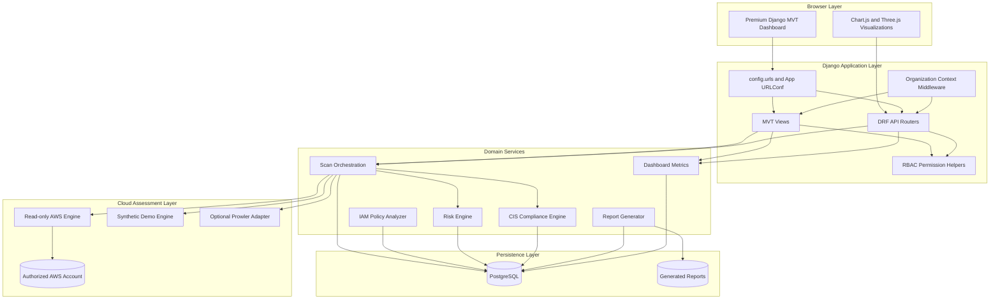
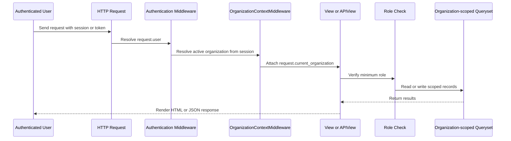
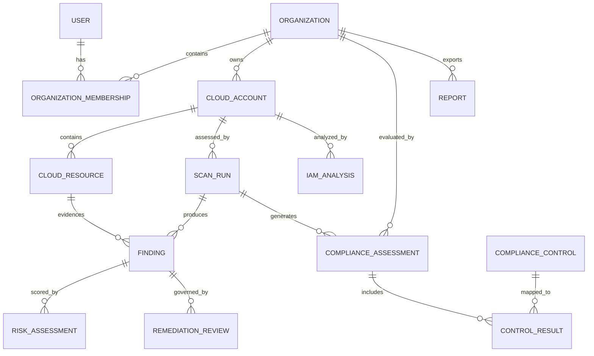
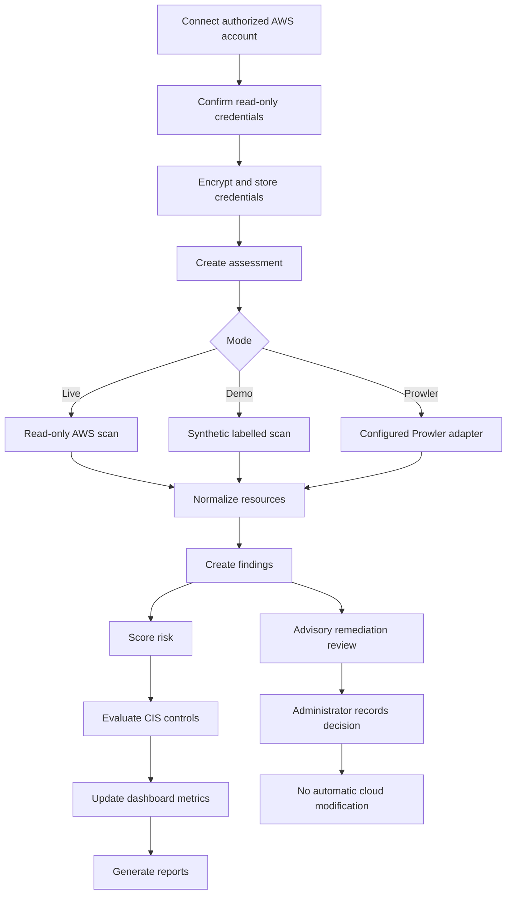

# CloudSentry

CloudSentry is a professional Cloud Security Posture Management platform built as a complete Django application. It provides organization-scoped cloud account management, read-only AWS assessments, IAM least-privilege analysis, CIS compliance evaluation, AI-assisted risk scoring, interactive visualization, and professional PDF/CSV reporting.

This README documents the application inside the `clous-sentry/` folder of the `Njbalamani/Cloud-Sentry` repository.

## Product identity

| Item | Detail |
| --- | --- |
| Product name | CLOUDSENTRY |
| Product type | AI-Powered Cloud Security Posture Management Platform |
| Application root | `clous-sentry/` |
| Backend | Django, Django REST Framework, PostgreSQL |
| Frontend | Django MVT, HTML5, CSS3, JavaScript, Chart.js, Three.js |
| API documentation | OpenAPI schema, Swagger UI, ReDoc |
| Deployment | Local development, Docker Compose, Gunicorn, WhiteNoise |
| License | MIT License, Copyright (c) 2026 Njbalamani |

## Security principles

| Principle | Implementation |
| --- | --- |
| Read-only by design | Live AWS scanning uses read-only APIs and never modifies cloud resources. |
| Explicit synthetic data | Demo resources, findings, scan runs, IAM records, and reports are labelled with `is_demo` or `synthetic_data`. |
| Encrypted credentials | Cloud credentials are encrypted with Fernet before storage and are never serialized by the UI or API read serializers. |
| Tenant isolation | All domain querysets are filtered by the active organization. |
| Role-based access | Owner, administrator, analyst, and viewer roles control UI and API actions. |
| Advisory remediation | Remediation approvals are records only; no automatic cloud changes are performed. |
| Secure defaults | CSRF, security headers, secure cookies, request IDs, and production secret validation are enabled. |

---

## Table of contents

1. [Architecture](#architecture)
2. [Technology stack](#technology-stack)
3. [Detailed project structure](#detailed-project-structure)
4. [Installation and configuration](#installation-and-configuration)
5. [Run commands](#run-commands)
6. [Application routes](#application-routes)
7. [Database model diagram](#database-model-diagram)
8. [Database table dictionary](#database-table-dictionary)
9. [Security workflow](#security-workflow)
10. [Testing and quality](#testing-and-quality)
11. [Deployment](#deployment)
12. [License](#license)

---

## Architecture



### Request and tenancy flow



---

## Technology stack

| Layer | Technology | Usage |
| --- | --- | --- |
| Language | Python 3.12 | Backend implementation |
| Web framework | Django 5 | MVT application, ORM, migrations, auth, admin structure |
| API | Django REST Framework | REST API, serializers, routers, OpenAPI schema |
| Database | PostgreSQL | Production data store |
| Local test database | SQLite in-memory | Automated test execution with `TESTING=1` |
| Frontend | HTML5, CSS3, JavaScript | Custom premium UI without Bootstrap |
| Visualization | Chart.js, Three.js | Metrics charts and cloud topology |
| Cloud SDK | Boto3 | Read-only AWS API access |
| Optional scanner | Prowler | External assessment adapter |
| Risk engine | scikit-learn | Local hybrid risk scoring |
| Optional AI | Gemini API | Optional risk explanation enrichment |
| Reporting | ReportLab and CSV | PDF and CSV evidence packages |
| Security | cryptography Fernet | Cloud credential encryption at rest |
| Static files | WhiteNoise | Static asset serving |
| WSGI server | Gunicorn | Production application server |
| Quality | Ruff, Django tests | Linting and automated verification |

---

## Detailed project structure

```text
clous-sentry/
├── .dockerignore                  Docker build exclusions
├── .env.example                   Environment variable template
├── .github/
│   └── workflows/
│       └── ci.yml                 Continuous integration workflow
├── .gitignore                     Git exclusion rules
├── Dockerfile                     Production container image
├── LICENSE                        MIT license in Njbalamani name
├── README.md                      Full application documentation
├── docker-compose.yml             PostgreSQL + web application stack
├── manage.py                      Django management entry point
├── pyproject.toml                 Ruff and pytest configuration
├── requirements.txt               Python dependency manifest
├── accounts/
│   ├── migrations/                User and login attempt migrations
│   ├── tests/                     Application test package
│   ├── admin.py                   Admin registrations
│   ├── apps.py                    App configuration
│   ├── forms.py                   Login, registration, profile forms
│   ├── models.py                  User and LoginAttempt models
│   ├── permissions.py             RBAC helpers and API permissions
│   ├── urls.py                    Accounts routes
│   └── views.py                   Login, register, logout, profile views
├── organizations/
│   ├── migrations/                Tenant migrations
│   ├── context_processors.py      Template context with active org and role
│   ├── forms.py                   Organization and member forms
│   ├── middleware.py              Active organization resolution
│   ├── models.py                  Organization and membership models
│   ├── services.py                Organization creation and membership services
│   ├── urls.py                    Organization routes
│   └── views.py                   Organization UI views
├── cloud_accounts/
│   ├── migrations/                Cloud account migrations
│   ├── api.py                     Cloud account and resource viewsets
│   ├── forms.py                   Secure account connection form
│   ├── models.py                  CloudAccount and CloudResource models
│   ├── serializers.py             API serializers
│   ├── services.py                Boto3 session and connection verification
│   ├── urls.py                    Cloud account routes
│   └── views.py                   Account UI and connection test views
├── cloud_scanner/
│   ├── engines/
│   │   ├── aws.py                 Read-only AWS assessment engine
│   │   ├── base.py                Scanner interfaces and finding drafts
│   │   ├── demo.py                Synthetic demo scan engine
│   │   └── prowler.py             Optional Prowler adapter
│   ├── management/commands/
│   │   ├── seed_demo_data.py      Synthetic demo data seeder
│   │   └── seed_rules.py          Security rule seeder
│   ├── migrations/                Scanner migrations
│   ├── api.py                     Scan, finding, and review viewsets
│   ├── forms.py                   Scan start, finding filter, review forms
│   ├── models.py                  ScanRule, ScanRun, Finding, Review models
│   ├── rules.py                   Built-in rule catalog
│   ├── services.py                Scan orchestration service
│   ├── urls.py                    Scanner routes
│   └── views.py                   Operations and finding UI views
├── iam_analyzer/
│   ├── migrations/                IAM analysis migrations
│   ├── analyzer.py                Policy analysis rules
│   ├── api.py                     IAM API viewset
│   ├── models.py                  IAMAnalysis model
│   ├── services.py                IAM collection service
│   ├── urls.py                    IAM routes
│   └── views.py                   IAM UI views
├── risk_engine/
│   ├── migrations/                Risk migrations
│   ├── api.py                     Risk API viewset
│   ├── engine.py                  Model training, scoring, explanations
│   ├── models.py                  RiskAssessment model
│   ├── urls.py                    Risk routes
│   └── views.py                   Risk UI views
├── compliance/
│   ├── management/commands/
│   │   └── seed_controls.py       CIS control seeder
│   ├── migrations/                Compliance migrations
│   ├── controls.py                CIS control catalog
│   ├── service.py                 Control evaluation service
│   ├── api.py                     Compliance API viewsets
│   ├── models.py                  Compliance models
│   ├── urls.py                    Compliance routes
│   └── views.py                   Compliance UI views
├── reports/
│   ├── migrations/                Report migrations
│   ├── api.py                     Report generation and download API
│   ├── forms.py                   Report generation form
│   ├── models.py                  Report model
│   ├── services.py                PDF and CSV generation services
│   ├── urls.py                    Report routes
│   └── views.py                   Report UI and download views
├── dashboard/
│   ├── api.py                     Metrics and topology API views
│   ├── api_urls.py                Dashboard API routes
│   ├── migrations/                Dashboard package marker
│   ├── services.py                Database-derived metrics and topology
│   ├── urls.py                    Dashboard route
│   └── views.py                   Dashboard view and landing redirect
├── config/
│   ├── api.py                     DRF router registrations
│   ├── asgi.py                    ASGI entry point
│   ├── error_views.py             Custom 403, 404, 500 handlers
│   ├── exception_handler.py       Consistent API error envelope
│   ├── settings.py                Central settings and security configuration
│   ├── urls.py                    Root URL configuration
│   └── wsgi.py                    WSGI entry point
├── templates/
│   ├── auth/                      Login, register, profile templates
│   ├── cloud_accounts/            Account list, connect, detail, resources
│   ├── cloud_scanner/             Operations, scans, findings, reviews
│   ├── compliance/                Compliance overview and detail
│   ├── components/                Reusable UI components
│   ├── dashboard/                 Dashboard page
│   ├── errors/                    403, 404, 500 pages
│   ├── iam_analyzer/              IAM list, detail, analyze pages
│   ├── organizations/             Organization list, detail, member pages
│   ├── reports/                   Report list and generation pages
│   ├── risk_engine/               Risk list and detail pages
│   └── base.html                  Main application shell
├── static/
│   ├── css/main.css               Premium design system
│   └── js/
│       ├── charts.js              Chart.js dashboard rendering
│       ├── main.js                General UI behavior
│       └── topology.js            Three.js topology rendering
├── docs/
│   ├── api.md                     API reference
│   ├── architecture.md            Architecture and deployment topology
│   ├── deployment.md              Production deployment guide
│   └── er-diagram.md              Entity relationship documentation
├── media/
│   └── .gitkeep                   Media directory marker
└── tests/
    ├── __init__.py                Test package marker
    └── test_platform.py           Core integration test suite
```

---

## Installation and configuration

### Prerequisites

| Requirement | Version or detail |
| --- | --- |
| Python | 3.12 or compatible |
| pip | Latest recommended |
| PostgreSQL | 14+ for production |
| Docker | Optional, for container deployment |
| Git | Any current version |
| AWS credentials | Read-only IAM credentials for live assessment |
| Prowler binary | Optional, only for Prowler scan mode |

### Environment variables

Copy `.env.example` to `.env` and configure the following values.

| Variable | Required | Default | Description |
| --- | --- | --- | --- |
| `SECRET_KEY` | Production yes | Development key | Django signing key. Production requires at least 50 characters. |
| `DEBUG` | Yes | `True` | Must be `False` in production. |
| `ALLOWED_HOSTS` | Production yes | `localhost,127.0.0.1` | Comma-separated Django host allowlist. |
| `CSRF_TRUSTED_ORIGINS` | Production yes | `http://localhost:8000` | Comma-separated CSRF origin allowlist. |
| `CORS_ALLOWED_ORIGINS` | Optional | empty | Comma-separated browser API origins. |
| `DATABASE_URL` | Production yes | local PostgreSQL URL | PostgreSQL connection string. |
| `TESTING` | No | `False` | Use `True` only for local SQLite or automated tests. |
| `DEMO_MODE` | Yes | `True` | Enables labelled synthetic assessments. |
| `ALLOW_PUBLIC_REGISTRATION` | Yes | `True` | Disable after first administrator provisioning. |
| `FIELD_ENCRYPTION_KEY` | Production yes | empty | Fernet key used for credential encryption. |
| `AI_EXPLANATIONS_ENABLED` | No | `False` | Enables optional Gemini explanation calls. |
| `GEMINI_API_KEY` | Conditional | empty | Required only when AI explanations are enabled. |
| `AWS_DEFAULT_REGION` | No | `us-east-1` | Default assessment region. |
| `PROWLER_BIN` | Conditional | empty | Required only for Prowler scan mode. |
| `SCAN_TIMEOUT_SECONDS` | No | `300` | Timeout for external scan adapters. |
| `LOG_LEVEL` | No | `INFO` | Application logging level. |

### Generate secret values

```powershell
.\.venv\Scripts\python.exe -c "from django.core.management.utils import get_random_secret_key; print(get_random_secret_key())"
.\.venv\Scripts\python.exe -c "from cryptography.fernet import Fernet; print(Fernet.generate_key().decode())"
```

---

## Run commands

### Local development setup

```powershell
cd clous-sentry
python -m venv .venv
.\.venv\Scripts\python.exe -m pip install --upgrade pip
.\.venv\Scripts\python.exe -m pip install -r requirements.txt
Copy-Item .env.example .env
```

### Local SQLite bootstrap

```powershell
$env:TESTING='1'
.\.venv\Scripts\python.exe manage.py migrate
.\.venv\Scripts\python.exe manage.py seed_rules
.\.venv\Scripts\python.exe manage.py seed_controls
.\.venv\Scripts\python.exe manage.py runserver
```

### Demo data bootstrap

```powershell
$env:TESTING='1'
.\.venv\Scripts\python.exe manage.py seed_demo_data --organization-slug your-organization-slug
```

After seeding, sign in and open **Scans > Start assessment**, choose **Synthetic demo assessment**, and run the assessment.

### Docker setup

```powershell
cd clous-sentry
Copy-Item .env.example .env
docker compose up --build
```

### Production release commands

```powershell
python -m pip install -r requirements.txt
python manage.py migrate
python manage.py seed_rules
python manage.py seed_controls
python manage.py collectstatic --noinput
gunicorn config.wsgi:application --bind 0.0.0.0:8000 --workers 3 --timeout 120
```

---

## Application routes

| Route | Purpose |
| --- | --- |
| `/` | Landing redirect |
| `/accounts/register/` | User and organization registration |
| `/accounts/login/` | Sign in |
| `/accounts/profile/` | Profile management |
| `/dashboard/` | Main security dashboard |
| `/organizations/` | Organization list |
| `/organizations/create/` | Organization creation |
| `/organizations/<slug>/members/` | Member management |
| `/cloud-accounts/` | Cloud account list |
| `/cloud-accounts/connect/` | Connect cloud account |
| `/cloud-accounts/<id>/` | Cloud account detail |
| `/scans/` | Security operations |
| `/scans/start/` | Start assessment |
| `/scans/runs/` | Assessment history |
| `/scans/findings/` | Finding list |
| `/iam/` | IAM analysis list |
| `/risk/` | Risk assessment list |
| `/compliance/` | Compliance overview |
| `/reports/` | Report list |
| `/reports/generate/` | Generate report |
| `/api/schema/` | OpenAPI schema |
| `/api/docs/` | Swagger UI |
| `/api/redoc/` | ReDoc |
| `/api/v1/` | REST API base path |

### API endpoint reference

| Endpoint | Methods | Description |
| --- | --- | --- |
| `/api/v1/organizations/` | GET | Accessible organizations |
| `/api/v1/organization-members/` | GET | Active members |
| `/api/v1/cloud-accounts/` | GET, POST | Cloud accounts |
| `/api/v1/cloud-resources/` | GET | Discovered resources |
| `/api/v1/scan-runs/` | GET, POST | Assessments |
| `/api/v1/scan-runs/{id}/run/` | POST | Run assessment |
| `/api/v1/scan-runs/{id}/findings/` | GET | Findings for one assessment |
| `/api/v1/findings/` | GET | Organization findings |
| `/api/v1/remediation-reviews/` | GET, POST | Advisory remediation reviews |
| `/api/v1/iam-analyses/` | GET | IAM analysis records |
| `/api/v1/risk-assessments/` | GET | Risk scores |
| `/api/v1/compliance-assessments/` | GET | Compliance assessments |
| `/api/v1/compliance-controls/` | GET | CIS control catalog |
| `/api/v1/reports/` | GET | Generated reports |
| `/api/v1/reports/generate/` | POST | Generate PDF or CSV report |
| `/api/v1/reports/{id}/download/` | GET | Download report |
| `/api/v1/dashboard/metrics/` | GET | Dashboard metrics |
| `/api/v1/dashboard/topology/` | GET | Cloud topology graph |

---

## Database model diagram



---

## Database table dictionary

The following tables document application-owned database columns. Django framework tables for sessions, auth permissions, content types, and REST tokens are also created by migrations.

### `accounts_user`

| Column | Type | Null | Default | Relation |
| --- | --- | --- | --- | --- |
| `id` | BigAutoField | NO | — | — |
| `password` | CharField | NO | — | — |
| `last_login` | DateTimeField | YES | — | — |
| `is_superuser` | BooleanField | NO | `False` | — |
| `email` | CharField | NO | — | — |
| `full_name` | CharField | NO | — | — |
| `role` | CharField | NO | `analyst` | — |
| `mfa_enabled` | BooleanField | NO | `False` | — |
| `is_active` | BooleanField | NO | `True` | — |
| `is_staff` | BooleanField | NO | `False` | — |
| `date_joined` | DateTimeField | NO | `now` | — |
| `created_at` | DateTimeField | NO | auto | — |
| `updated_at` | DateTimeField | NO | auto | — |

### `accounts_loginattempt`

| Column | Type | Null | Default | Relation |
| --- | --- | --- | --- | --- |
| `id` | BigAutoField | NO | — | — |
| `email` | CharField | NO | — | — |
| `ip_address` | GenericIPAddressField | YES | — | — |
| `success` | BooleanField | NO | `False` | — |
| `created_at` | DateTimeField | NO | auto | — |

### `organizations_organization`

| Column | Type | Null | Default | Relation |
| --- | --- | --- | --- | --- |
| `id` | BigAutoField | NO | — | — |
| `name` | CharField | NO | — | — |
| `slug` | SlugField | NO | auto slug | — |
| `description` | TextField | NO | — | — |
| `is_active` | BooleanField | NO | `True` | — |
| `created_by_id` | ForeignKey | YES | — | `accounts_user` |
| `created_at` | DateTimeField | NO | auto | — |
| `updated_at` | DateTimeField | NO | auto | — |

### `organizations_organizationmembership`

| Column | Type | Null | Default | Relation |
| --- | --- | --- | --- | --- |
| `id` | BigAutoField | NO | — | — |
| `user_id` | ForeignKey | NO | — | `accounts_user` |
| `organization_id` | ForeignKey | NO | — | `organizations_organization` |
| `role` | CharField | NO | `analyst` | — |
| `is_active` | BooleanField | NO | `True` | — |
| `joined_at` | DateTimeField | NO | auto | — |

### `cloud_accounts_cloudaccount`

| Column | Type | Null | Default | Relation |
| --- | --- | --- | --- | --- |
| `id` | BigAutoField | NO | — | — |
| `organization_id` | ForeignKey | NO | — | `organizations_organization` |
| `name` | CharField | NO | — | — |
| `provider` | CharField | NO | `aws` | — |
| `account_identifier` | CharField | NO | — | — |
| `region` | CharField | NO | `us-east-1` | — |
| `credential_type` | CharField | NO | `assume_role` | — |
| `role_arn` | CharField | NO | — | — |
| `encrypted_credentials` | TextField | NO | — | — |
| `credential_version` | PositiveIntegerField | NO | `0` | — |
| `is_read_only` | BooleanField | NO | `True` | — |
| `scan_enabled` | BooleanField | NO | `True` | — |
| `status` | CharField | NO | `pending` | — |
| `notes` | TextField | NO | — | — |
| `last_checked_at` | DateTimeField | YES | — | — |
| `created_by_id` | ForeignKey | YES | — | `accounts_user` |
| `created_at` | DateTimeField | NO | auto | — |
| `updated_at` | DateTimeField | NO | auto | — |

### `cloud_accounts_cloudresource`

| Column | Type | Null | Default | Relation |
| --- | --- | --- | --- | --- |
| `id` | BigAutoField | NO | — | — |
| `cloud_account_id` | ForeignKey | NO | — | `cloud_accounts_cloudaccount` |
| `resource_id` | CharField | NO | — | — |
| `resource_type` | CharField | NO | — | — |
| `name` | CharField | NO | — | — |
| `region` | CharField | NO | — | — |
| `metadata` | JSONField | NO | `{}` | — |
| `tags` | JSONField | NO | `{}` | — |
| `risk_level` | CharField | NO | `none` | — |
| `is_demo` | BooleanField | NO | `False` | — |
| `discovered_at` | DateTimeField | NO | auto | — |
| `last_seen_at` | DateTimeField | NO | auto | — |

### `cloud_scanner_scanrule`

| Column | Type | Null | Default | Relation |
| --- | --- | --- | --- | --- |
| `id` | BigAutoField | NO | — | — |
| `rule_id` | CharField | NO | — | — |
| `title` | CharField | NO | — | — |
| `description` | TextField | NO | — | — |
| `provider` | CharField | NO | `aws` | — |
| `service` | CharField | NO | — | — |
| `category` | CharField | NO | — | — |
| `severity` | CharField | NO | `medium` | — |
| `cis_control` | CharField | NO | — | — |
| `benchmark` | CharField | NO | `CIS AWS Foundations v2.0` | — |
| `remediation` | JSONField | NO | `{}` | — |
| `enabled` | BooleanField | NO | `True` | — |
| `created_at` | DateTimeField | NO | auto | — |
| `updated_at` | DateTimeField | NO | auto | — |

### `cloud_scanner_scanrun`

| Column | Type | Null | Default | Relation |
| --- | --- | --- | --- | --- |
| `id` | BigAutoField | NO | — | — |
| `organization_id` | ForeignKey | NO | — | `organizations_organization` |
| `cloud_account_id` | ForeignKey | NO | — | `cloud_accounts_cloudaccount` |
| `initiated_by_id` | ForeignKey | YES | — | `accounts_user` |
| `status` | CharField | NO | `pending` | — |
| `scan_mode` | CharField | NO | `live` | — |
| `started_at` | DateTimeField | NO | auto | — |
| `finished_at` | DateTimeField | YES | — | — |
| `updated_at` | DateTimeField | NO | auto | — |
| `resources_scanned` | PositiveIntegerField | NO | `0` | — |
| `findings_count` | PositiveIntegerField | NO | `0` | — |
| `summary` | JSONField | NO | `{}` | — |
| `error_message` | TextField | NO | — | — |

### `cloud_scanner_finding`

| Column | Type | Null | Default | Relation |
| --- | --- | --- | --- | --- |
| `id` | BigAutoField | NO | — | — |
| `scan_run_id` | ForeignKey | NO | — | `cloud_scanner_scanrun` |
| `cloud_account_id` | ForeignKey | NO | — | `cloud_accounts_cloudaccount` |
| `resource_id` | ForeignKey | YES | — | `cloud_accounts_cloudresource` |
| `rule_id` | ForeignKey | YES | — | `cloud_scanner_scanrule` |
| `title` | CharField | NO | — | — |
| `description` | TextField | NO | — | — |
| `severity` | CharField | NO | `medium` | — |
| `status` | CharField | NO | `open` | — |
| `evidence` | JSONField | NO | `{}` | — |
| `remediation` | JSONField | NO | `{}` | — |
| `risk_score` | FloatField | NO | `0` | — |
| `is_demo` | BooleanField | NO | `False` | — |
| `created_at` | DateTimeField | NO | auto | — |
| `updated_at` | DateTimeField | NO | auto | — |

### `cloud_scanner_remediationreview`

| Column | Type | Null | Default | Relation |
| --- | --- | --- | --- | --- |
| `id` | BigAutoField | NO | — | — |
| `finding_id` | ForeignKey | NO | — | `cloud_scanner_finding` |
| `reviewer_id` | ForeignKey | YES | — | `accounts_user` |
| `decision` | CharField | NO | `pending` | — |
| `notes` | TextField | NO | — | — |
| `proposed_action` | JSONField | NO | `{}` | — |
| `reviewed_at` | DateTimeField | NO | auto | — |

### `iam_analyzer_iamanalysis`

| Column | Type | Null | Default | Relation |
| --- | --- | --- | --- | --- |
| `id` | BigAutoField | NO | — | — |
| `cloud_account_id` | ForeignKey | NO | — | `cloud_accounts_cloudaccount` |
| `scan_run_id` | ForeignKey | YES | — | `cloud_scanner_scanrun` |
| `principal_arn` | CharField | NO | — | — |
| `policy_name` | CharField | NO | — | — |
| `policy_document` | JSONField | NO | `{}` | — |
| `findings` | JSONField | NO | `[]` | — |
| `recommendations` | JSONField | NO | `[]` | — |
| `risk_score` | FloatField | NO | `0` | — |
| `is_demo` | BooleanField | NO | `False` | — |
| `analyzed_at` | DateTimeField | NO | auto | — |
| `analyzed_by_id` | ForeignKey | YES | — | `accounts_user` |

### `risk_engine_riskassessment`

| Column | Type | Null | Default | Relation |
| --- | --- | --- | --- | --- |
| `id` | BigAutoField | NO | — | — |
| `finding_id` | ForeignKey | NO | — | `cloud_scanner_finding` |
| `score` | FloatField | NO | — | — |
| `severity_band` | CharField | NO | — | — |
| `model_version` | CharField | NO | — | — |
| `factors` | JSONField | NO | `{}` | — |
| `explanation` | TextField | NO | — | — |
| `remediation_summary` | TextField | NO | — | — |
| `source` | CharField | NO | `local` | — |
| `created_at` | DateTimeField | NO | auto | — |

### `compliance_compliancecontrol`

| Column | Type | Null | Default | Relation |
| --- | --- | --- | --- | --- |
| `id` | BigAutoField | NO | — | — |
| `framework` | CharField | NO | `CIS AWS Foundations Benchmark v2.0` | — |
| `control_id` | CharField | NO | — | — |
| `title` | CharField | NO | — | — |
| `description` | TextField | NO | — | — |
| `severity` | CharField | NO | `medium` | — |
| `rule_ids` | JSONField | NO | `[]` | — |
| `enabled` | BooleanField | NO | `True` | — |
| `created_at` | DateTimeField | NO | auto | — |
| `updated_at` | DateTimeField | NO | auto | — |

### `compliance_complianceassessment`

| Column | Type | Null | Default | Relation |
| --- | --- | --- | --- | --- |
| `id` | BigAutoField | NO | — | — |
| `organization_id` | ForeignKey | NO | — | `organizations_organization` |
| `scan_run_id` | ForeignKey | YES | — | `cloud_scanner_scanrun` |
| `score` | FloatField | NO | `0` | — |
| `passed` | PositiveIntegerField | NO | `0` | — |
| `failed` | PositiveIntegerField | NO | `0` | — |
| `total` | PositiveIntegerField | NO | `0` | — |
| `summary` | JSONField | NO | `{}` | — |
| `created_at` | DateTimeField | NO | auto | — |

### `compliance_controlresult`

| Column | Type | Null | Default | Relation |
| --- | --- | --- | --- | --- |
| `id` | BigAutoField | NO | — | — |
| `assessment_id` | ForeignKey | NO | — | `compliance_complianceassessment` |
| `control_id` | ForeignKey | NO | — | `compliance_compliancecontrol` |
| `status` | CharField | NO | `passed` | — |
| `evidence` | JSONField | NO | `{}` | — |

### `reports_report`

| Column | Type | Null | Default | Relation |
| --- | --- | --- | --- | --- |
| `id` | BigAutoField | NO | — | — |
| `organization_id` | ForeignKey | NO | — | `organizations_organization` |
| `created_by_id` | ForeignKey | YES | — | `accounts_user` |
| `report_type` | CharField | NO | — | — |
| `file_format` | CharField | NO | `pdf` | — |
| `file` | FileField | NO | — | — |
| `status` | CharField | NO | `completed` | — |
| `parameters` | JSONField | NO | `{}` | — |
| `created_at` | DateTimeField | NO | auto | — |

---

## Security workflow



### Integrity rules

| Rule | Scope | Purpose |
| --- | --- | --- |
| `unique_user_organization` | Membership | One active membership record per user and organization |
| `unique_cloud_account_per_organization` | Cloud account | Prevent duplicate AWS account connections per tenant |
| `unique_resource_per_account` | Cloud resource | Deduplicate discovered resources by resource ID |
| `unique_framework_control` | Compliance control | One control ID per framework |
| `unique_control_per_assessment` | Control result | One result per control per assessment |
| Organization queryset filtering | All domain data | Prevent cross-tenant access |
| `field_encryption` | Cloud credentials | Protect secret material at rest |

---

## Testing and quality

### Run all verification commands

```powershell
$env:TESTING='1'
.\.venv\Scripts\python.exe manage.py check
.\.venv\Scripts\python.exe manage.py makemigrations --check --dry-run
.\.venv\Scripts\python.exe manage.py test tests -v 2
.\.venv\Scripts\python.exe -m ruff check .
```

### Test coverage areas

| Area | Verified behavior |
| --- | --- |
| Registration | User creation, organization creation, owner membership |
| Authentication | Login flow and failed-attempt lockout |
| Tenant isolation | Cross-organization account detail is not accessible |
| UI rendering | Key application pages render successfully |
| Credential security | Secrets are encrypted and not stored in plaintext |
| Demo scan | Synthetic scan creates labelled findings |
| Risk and compliance | Scan scoring and control evaluation complete |
| Dashboard API | Metrics and topology are scoped to the active organization |
| Reports | CSV download and PDF generation work |
| Static assets | Production static collection succeeds |

---

## Deployment

### Production checklist

| Check | Required action |
| --- | --- |
| `DEBUG` | Set to `False` |
| `SECRET_KEY` | Use a unique key of at least 50 characters |
| `FIELD_ENCRYPTION_KEY` | Set a stable Fernet key before storing credentials |
| Database | Use managed PostgreSQL with backups |
| Registration | Set `ALLOW_PUBLIC_REGISTRATION=False` after provisioning |
| Demo mode | Set `DEMO_MODE=False` unless demonstrations are required |
| Hosts | Configure `ALLOWED_HOSTS`, `CSRF_TRUSTED_ORIGINS`, and CORS origins |
| AWS access | Use read-only IAM credentials only |
| Prowler | Configure `PROWLER_BIN` only if the binary is approved and installed |
| Media storage | Mount persistent storage for generated reports |
| TLS | Terminate TLS at a trusted reverse proxy |
| Monitoring | Track `X-Request-ID` and application logs |

### Docker deployment

```powershell
docker compose up --build
```

### Gunicorn deployment

```powershell
python manage.py migrate
python manage.py collectstatic --noinput
gunicorn config.wsgi:application --bind 0.0.0.0:8000 --workers 3 --timeout 120
```

Additional deployment detail is available in `docs/deployment.md`, API detail in `docs/api.md`, and architecture detail in `docs/architecture.md`.

---

## License

MIT License.

Copyright (c) 2026 Njbalamani.

Permission is granted to use, copy, modify, merge, publish, distribute, sublicense, and sell copies of the software subject to the license terms included in [`LICENSE`](./LICENSE).
